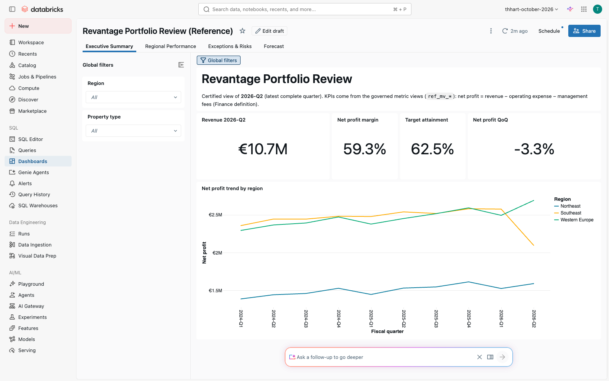

# Revantage Luxembourg Onsite — Build-Along Workshop (Modules 0–18)

Two-day, hands-on workshop for the Revantage Luxembourg data team (day 1 = 2026-10-13): Genie One and Genie Code,
Agent Bricks (extraction + Knowledge Assistant), UC metric views, AI/BI dashboards, Databricks Apps, Unity Catalog
governance, Lakeflow, Lakebase, AI Gateway, `ai_forecast`, and data quality. **Participants build every asset
themselves**; this repo holds the starting state, a verified reference ("answer key") for each demo, and a Genie Code
prompt library with expected results per stage.

**One dataset tells one story:** Southeast net profit fell **−18.6%** in 2026-Q2. It's almost all **Harbor Tower**: its anchor
tenant left on 31 March, and a **€312k chiller replacement** (invoice HV-2026-0417) was booked as OpEx although policy says
CapEx and needs two signatures. Every demo finds a piece of it. Facts and numbers: `notes/agent-notes/data-contract.md`.

## Where things are

| Path | What |
|---|---|
| `code/prompts/dNN-*.md` | **Build-along guides**: per stage the Genie Code prompt, expected result, checkpoint, if-stuck. Start here. |
| `code/prompts/verification/` | Recorded Genie / KA answers (Conversation API transcripts) |
| `code/data-gen/`, `code/documents/` | Deterministic dataset generator (planted facts asserted) and the 15 PDFs |
| `code/setup/` | Starting-state job (volumes → bronze/silver/gold), participant sandboxes, SQL runner; `participant_setup.py`: Module 0 notebook that builds a participant's own copy from their Git folder |
| `code/reference/`, `code/pipelines/`, `code/genie/`, `code/dashboards/` | Reference solutions |
| `code/app/`, `code/app-approvals/` | Next.js apps (lease tracker, invoice approvals on Lakebase) |
| `code/preflight/preflight.py` | Read-only readiness check for the client workspace (go/no-go per demo) |
| `code/tests/` | Smoke tests and API testers (`check_starting_state.py`, `check_ref_pipeline.py`, `ask_genie.py`, `ask_ka.py`) |
| `RUNBOOK.md` | Rebuild anywhere, resets between sessions, teardown, gotchas |

## Demo → assets (all verified 2026-10-08 on `fevm-thhart-october-2026`)

| # | Session | Participants build | Reference | Verified by |
|---|---|---|---|---|
| 0 | Getting started | Git folder with this repo + own copy of the data (`participant_setup.py`) | shared starting state | Run all into a scratch schema: 8/8 PASS, `check_starting_state.py` ALL PASS, 0 rows differ (2026-10-14) |
| 1 | Platform overview | first queries, Genie Code | — | SQL |
| 2 | Genie One | 5 business questions | Genie Agent *Portfolio Q&A (Start)* | Conversation API 5/5 |
| 3 | Genie Code | migrate a broken Snowflake view | `ref_d03_property_performance_v` | 176 → 64 rows |
| 4 | Extraction agent | Information Extraction over invoices | agent `extract-invoices-…`, `ref_invoices_extracted` | 72/72 fields |
| 5 | Knowledge Assistant | policy Q&A with citations | `revantage-policy-assistant` | 6/6 cited |
| 6 | Data exploration | 5 audit questions → a check view | `ref_d06_property_quality_checks` | API 5/5 |
| 7 | Metric views | 3 governed KPIs | `ref_mv_net_profit_margin`, `ref_mv_target_attainment`, `ref_mv_qoq_revenue_growth` | SQL + Genie |
| 8 | AI/BI dashboard | 3-page portfolio review | *Revantage Portfolio Review (Reference)* | browser |
| 9 | Apps | lease expiry tool | app `revantage-lease-tracker` | Playwright 27 + browser |
| 10 | Governance | descriptions, certification, masks | `d10_governance.sql` / `d10_reset.sql` | apply + reset |
| 11 | Lakeflow | bronze → silver → gold pipeline | `ref_property_pipeline` (`ref_d11_*`) | = oracle; failure loop |
| 12 | Lakebase | approval workflow | `revantage-lux-ops`, app `revantage-invoice-approvals`, job → `silver_invoices` | Playwright 5 + browser + job |
| 13 | AI Gateway | usage, cost, alert | `d13_ai_gateway_queries.sql`, alert *Daily AI tokens > 1M* | queries on real rows |
| 14 | Forecasting | `ai_forecast` vs target | `ref_d14_revenue_forecast`, dashboard *Forecast* page | SQL |
| 15 | Lab | own Genie/dashboard/pipeline | tracks reuse the references | — |
| 16 | Data quality | monitoring, bad load, blast radius | outlier rule + alert, lineage query | rehearsed on a clone |
| 17 | Genie accuracy ladder | a Genie Agent made accurate one metadata layer at a time, benchmarked after each | *Revantage Accuracy Lab (Reference)*, `ref_d17_*`, `ref_d17_benchmark_results` | UI: 20 → 10 → 30 → 50 → 100 → 100 %; script ladder 5 → 100 % |
| 18 | Domains, Pages & Metrics | a Page (definition, synonyms, related metric view) Genie One reads | `code/reference/d18_pages.md`, domain via `code/scripts/d18_domain.sh` | Page via Genie Code + Genie One read it (draft, FEVM); domain pending (Revantage) |

UI-only Genie Code responses (participants' prompts typed in the product) are marked "UI verification pending (S9)" in each guide.

## Assets Created (dev target, `thhart_october_2026_catalog.revantage_20261008`)

### Data Assets
| Asset | Type | Rows | Notes |
|---|---|---|---|
| `raw` / `documents` | Volumes | 7 CSVs / 15 PDFs | `documents/{invoices,policies,leases}` |
| `bronze_regions`, `bronze_properties`, `bronze_tenants`, `bronze_leases`, `bronze_gl_accounts`, `bronze_gl_transactions`, `bronze_quarterly_targets` | Tables | 3 · 10 · 40 · 52 · 15 · 2,696 · 96 | raw extracts with planted issues |
| `silver_regions`, `silver_properties`, `silver_tenants`, `silver_leases`, `silver_gl_accounts`, `silver_gl_transactions`, `silver_quarterly_targets` | Tables | 3 · 8 · 40 · 50 · 15 · 2,681 · 96 | cleaned |
| `gold_property_quarterly` | Table | 80 | certified fact; no description by design (D10) |
| `customer_performance` | Table | 470 | tenant-level, PII columns |
| `ref_mv_net_profit_margin`, `ref_mv_target_attainment`, `ref_mv_qoq_revenue_growth` | Metric views | — | D7 |
| `ref_d03_property_performance_v`, `ref_d06_property_quality_checks` | Views | 64 · 5 | D3, D6 |
| `ref_d14_revenue_forecast` | Table | 96 | 80 actual + 16 forecast |
| `ref_invoices_extracted` | Table | 8 | D4 (VARIANT response) |
| `ref_d11_*` (7 bronze, 7 silver, 1 gold) | Pipeline tables | gold 80 | D11 |
| `silver_invoices` | Table | 0 (reset) | D12 job target |
| `ref_d12_gold_property_quarterly_synced` | Synced table → Lakebase | 80 | D12 reverse ETL |
| `ref_d13_payload` | AI Gateway inference table | — | D13, on `databricks-claude-sonnet-4-6` |
| `legacy_prp_mstr`, `legacy_gl_acct`, `legacy_gl_txn`, `legacy_lse`, `legacy_tnt`, `legacy_qtr_tgt` | Tables | 8 · 15 · 2,681 · 52 · 40 · 96 | D17 starting state: legacy names, coded values, lease history |
| `legacy_data_dictionary`, `d17_benchmark` | Tables | 39 · 10 | D17 documentation + benchmark (ground-truth SQL) |
| `ref_d17_properties`, `ref_d17_gl_accounts`, `ref_d17_gl_transactions`, `ref_d17_leases`, `ref_d17_tenants`, `ref_d17_quarterly_targets` | Tables | as legacy | D17 reference business layer (comments, descriptions, PK/FK) |
| `ref_d17_benchmark_results` | Table | 140 | D17 ladder scores per rung (`code/genie/d17_ladder.py`) |

### Workspace Assets
| Asset | Type | ID / URL |
|---|---|---|
| Revantage Portfolio Q&A (Start) | Genie Agent | `01f1c34be4d710108435324ff679d6d0` |
| Revantage Portfolio Q&A (Reference) | Genie Agent | `01f1c34be4d01738b7f2b3edb0d6519e` |
| Revantage Accuracy Lab (Start) | Genie Agent (D17, rung R1 + benchmark) | `01f1c499511a1c41bbc1080a108afb8d` |
| Revantage Accuracy Lab (Reference) | Genie Agent (D17, rung R7 + benchmark) | `01f1c499511d1b439428205a6f20876a` |
| Revantage Portfolio Review (Reference) | AI/BI dashboard | `01f1c34dfe2512409da1088ec1fd786c` |
| revantage-lease-tracker | App | https://revantage-lease-tracker-7474657569423450.aws.databricksapps.com |
| revantage-invoice-approvals | App (Lakebase) | https://revantage-invoice-approvals-7474657569423450.aws.databricksapps.com |
| revantage-lux-ops | Lakebase instance (CU_1), db `revantage_ops`, schema `approvals` | — |
| extract-invoices-2026-10-08-15-39-15 | Agent Bricks Information Extraction (UI) | tile `9faad089-fd97-4454-9db4-fde4c307a5c3` |
| revantage-policy-assistant | Agent Bricks Knowledge Assistant (UI) | tile `234e391f-…`, endpoint `ka-234e391f-endpoint` |
| [Revantage workshop] Setup starting state | Job | `7631543165762` |
| [Revantage workshop] Participant sandboxes | Job | `631298516624925` |
| [Revantage workshop] Reference: D3 view, D6 checks, D7 metric views, D14 forecast, D17 business layer | Job | `233222683471774` |
| [Revantage workshop] Approved invoices -> silver (Reference) | Job (paused schedule) | `645664061467007` |
| [Revantage workshop] Property Pipeline (Reference) | Lakeflow pipeline | `20bb119a-4c33-49f7-9d9e-b0d44bc7fbbe` |
| Daily AI tokens > 1M (Reference) · Revenue > 3 sigma from property mean (Reference) | SQL alerts | `466768273185035` · `466768273185039` |
| AI Gateway on `databricks-claude-sonnet-4-6` | usage tracking + inference table (script) | original config saved in `code/ai-gateway/` |
| Domain "Revantage Workshop" + governed tag | Discover domain (account level, D18) | Revantage workspace only (`code/scripts/d18_domain.sh`); FEVM is at its governed-tag limit |

## Deliverables (`assets/`)
| File | What | Source |
|---|---|---|
| `click-path.md` / `.docx` | Facilitator build-along walkthrough: 18 demos, every stage, prompt, checkpoint, watch-out, live screenshot | `code/deliverables/build_docs.py` (compiled from `code/prompts/`) |
| `participant-handout.md` / `.docx` | Participant version: prompts, checkpoints, fallbacks; Snowflake view appendix | same script |
| `…-internal.pptx` | Internal enablement deck (25 slides): build-live model, per-demo problem / build / value / why Databricks / watch-out | `code/deliverables/build_decks.py` (Databricks template, `slide_kit/`) |
| `…-client.pptx` | Client deck (26 slides): build-along steps with the prompt you type, checkpoint, fallback; outcomes; proposed next steps | same script |
| `…-modules.pptx` (166 slides) | Module-by-module build-along deck: per demo a "What we'll build" overview, "How we'll get there" steps, then one slide per step/prompt with the prompt (or click-path / SQL), the expected result, the fallback and a live screenshot of the expected output | `code/deliverables/build_modules_deck.py` (text from the guides; screenshots per `module_manifest.py`, SQL checkpoints via `capture_queries.py`) |
| `architecture.png` / `.drawio` | Every asset in the inventory above | `code/deliverables/architecture.py` (drawio-diagram skill) |
| `hero.png` | Portfolio Review dashboard | browser capture |

## Status
- All 16 demos have a verified reference, and every participant Genie Code prompt has been run in the UI (`code/prompts/verification/s9-genie-code-ui.md`); only D16 Stage 2 needs the Revantage workspace (FEVM monitor limit).
- Deliverables built 2026-10-09 (above).
- Revantage workspace access pending → run `code/preflight/preflight.py`, fill the `revantage` target, follow `RUNBOOK.md`.
