# Revantage Luxembourg workshop: build-along click-path

Two days, 16 demos, one dataset. Every participant builds each asset in their own schema (`<my_schema>`), guided by Genie Code; the finished answer key is deployed as `ref_*` objects. Each demo below is a Critical User Journey: numbered stages with the exact prompt, the expected result, the checkpoint, and the recovery path. Every prompt was run in the Genie Code UI on 2026-10-08/09 (log: `code/prompts/verification/s9-genie-code-ui.md`).

Placeholders: `<catalog>` and `<schema>` are the shared workshop catalog and schema (`revantage_20261008`); `<my_schema>` is your sandbox schema; `:workspace_id` is the number after `?o=` in your browser URL.

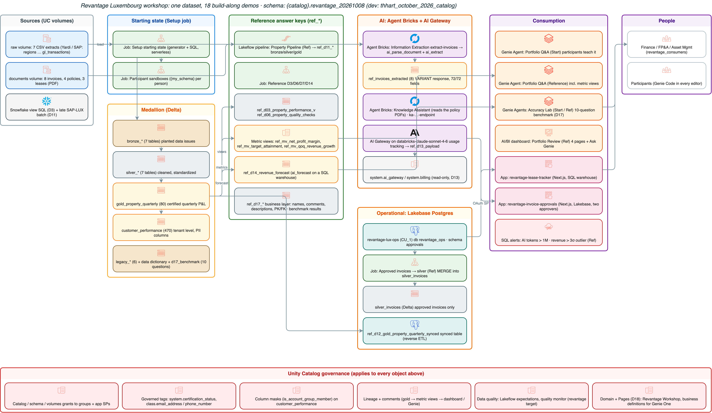

## Contents

- [Demo 1: Welcome & Platform Overview — "Where does my data live?"](#demo-1)
- [Demo 2: Genie One — Property Performance Q&A](#demo-2)
- [Demo 3: Genie Code — migrate and fix a Snowflake view](#demo-3)
- [Demo 4: Extraction Agent — "Invoice-to-Table"](#demo-4)
- [Demo 5: Knowledge Assistant — "Ask the Policy Book"](#demo-5)
- [Demo 6: Genie One Data Exploration — "Audit your data before you trust it"](#demo-6)
- [Demo 7: Semantic Layer & UC Metric Views — "Define Net Profit Margin once"](#demo-7)
- [Demo 8: AI/BI Dashboards — "Executive Portfolio Review"](#demo-8)
- [Demo 9: Databricks Apps — "Lease Expiry Tracker"](#demo-9)
- [Demo 10: Unity Catalog & Governance — "Who can see what, and why?"](#demo-10)
- [Demo 11: Lakeflow — "Bronze-Silver-Gold in 20 minutes"](#demo-11)
- [Demo 12: Lakebase & Production Operations — "Approval workflow state machine"](#demo-12)
- [Demo 13: AI Gateway & Monitoring — "Who's using what, and what's it costing us?"](#demo-13)
- [Demo 14: Time Series Forecasting — "Where is revenue heading?"](#demo-14)
- [Demo 15: Hands-On Lab — Build Your Own](#demo-15)
- [Demo 16: Data Quality & Observability — "Trust scorecard"](#demo-16)

<a id="demo-1"></a>
## Demo 1: Welcome & Platform Overview — "Where does my data live?"

**Session:** Day 1, 9:00–9:30 (30 min) · **You build:** your bearings: catalog, SQL editor, Genie Code · **Reference:** none (navigation)
**Starting state:** `<catalog>.<schema>` with `bronze_*` (7), `silver_*` (7), `gold_property_quarterly`, `customer_performance`; volumes `raw` (7 CSVs) and `documents` (`invoices/` 8, `policies/` 4, `leases/` 3 PDFs)
**Where:** Catalog Explorer, SQL editor, Genie Code side panel


*Everything the workshop builds, on one governed dataset.*

### Stage 1: Open platform, 3 minutes of talk

Delta/Iceberg in your own cloud storage (S3/ADLS/GCS); any model (Claude, GPT, open source, behind the AI Gateway); any data type (tables, PDFs, Excel). Unity Catalog governs all of it.

### Stage 2: The three-level namespace (7 min)

**Catalog** → `<catalog>` → `<schema>`: point out tables, views, metric views (later), volumes, functions.
Snowflake mapping: database ≈ catalog, schema = schema, stage ≈ volume, warehouse ≈ SQL warehouse.
**Checkpoint:** open `documents` → `invoices/` → preview `HV-2026-0417.pdf` in the browser.

### Stage 3: First query (5 min)

SQL editor, Serverless warehouse:
```sql
SELECT * FROM <catalog>.<schema>.gold_property_quarterly LIMIT 10;
SELECT COUNT(*) AS rows, COUNT(DISTINCT property_id) AS properties, MIN(fiscal_quarter), MAX(fiscal_quarter)
FROM <catalog>.<schema>.gold_property_quarterly;
```
**Expected:** **80** rows · **8** properties · 2024-Q1 · 2026-Q2.

### Stage 4: Meet Genie Code (10 min)

Open the Genie Code panel (top right):
> What tables are in <catalog>.<schema> and how do the bronze, silver and gold tables relate?

**Expected:** Genie Code explains raw → cleaned → aggregated and names `gold_property_quarterly` as the fact table.
> Write a query showing 2026-Q2 net profit by region from gold_property_quarterly.

**Expected:** Western Europe ≈ €2.69M, Northeast ≈ €1.59M, Southeast ≈ €2.09M.

### Stage 5: Any data type (5 min)

**Prompt:**
> Read the PDFs in /Volumes/<catalog>/<schema>/documents/leases/ with read_files as binaryFile and parse them with ai_parse_document.

**Expected:** 3 rows, ~20 elements each; the first element of `lease-harbor-tower-anchor.pdf` is **"EXPIRED"** (the anchor tenant who left on 31 March; we'll see the impact all day).
```sql
SELECT path, ai_parse_document(content, map('version','2.0')):document.elements[0].content::string AS first_element
FROM read_files('/Volumes/<catalog>/<schema>/documents/leases/', format => 'binaryFile')
```

### Wrap-up

- **So what:** everyone can find the data, run a query, and ask Genie Code before the real work starts.
- **Verified:** 2026-10-08 on the FEVM workspace: counts (80 / 8 / 2024-Q1–2026-Q2), Q2 by region from gold, and the lease parse (3 files, first element "EXPIRED", ~20 elements each) run in SQL. **Stages 4–5 run in the Genie Code UI (S9):** S4 Genie Code listed bronze/silver/gold, named `gold_property_quarterly` as the quarterly P&L fact table (it also sees the `ref_*` answer-key objects and pipeline internals: say so up front), and returned €2.69M / €2.09M / €1.59M; S5 it parsed the 3 lease PDFs (21 / 20 / 21 elements) with Harbor Tower's first element "EXPIRED".

<a id="demo-2"></a>
## Demo 2: Genie One — Property Performance Q&A

**Session:** Day 1, 9:30–10:15 (45 min) · **You build:** five answered, shareable business questions · **Reference:** Genie Agent "Revantage Portfolio Q&A (Reference)"
**Starting state:** Genie Agent "Revantage Portfolio Q&A (Start)" over `gold_property_quarterly`, `silver_properties`, `bronze_properties`, `silver_leases`, `silver_tenants`
**Where:** Genie One (browser), then the desktop/mobile app if installed

Open the Start agent from Genie One (left nav **Genie** → *Revantage Portfolio Q&A (Start)*). Ask each
question, then open **Show thinking** and **Show code** on every answer. That's the habit to build:
read the SQL behind the number.

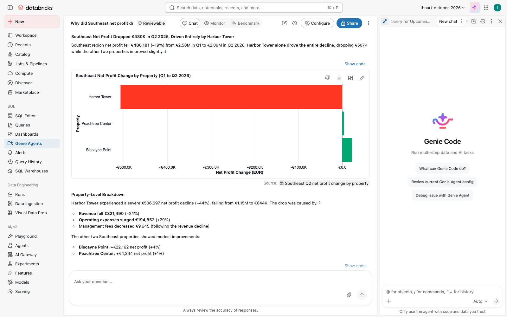

*Genie One answers the Southeast question: Harbor Tower drives the whole drop.*

### Stage 1: Who missed target? (6 min)

**Prompt** (Genie One):
> Which properties missed their quarterly target in 2026-Q2?

**Expected:** 3 properties: Peachtree Center (−€71,293), Harbor Tower (−€43,235), Zuidas Residences (−€41,702).
**Checkpoint:** open *Show code*: `WHERE fiscal_quarter = '2026-Q2' AND met_target = false` on `gold_property_quarterly`.
**If stuck:** ask the same question in the Reference agent; it answers from the metric view `ref_mv_target_attainment`.

### Stage 2: What changed in the Southeast? (8 min)

**Prompt:**
> What changed from Q1 to Q2 for the Southeast region?

**Expected:** revenue down ~€267k (−6.4%), operating expense up ~€221k, net profit €2.58M → €2.09M (−18.6%).
Then follow up in the same thread:
> Which property drove that, and was it revenue or costs?

**Expected:** **Harbor Tower**, net profit −€507k: revenue −€321k (anchor tenant left on 31 March) and costs +€185k.
**Checkpoint:** Harbor Tower is the only Southeast property whose net profit fell.
**If stuck:** in the Reference agent, ask "Why did Southeast net profit drop in Q2?".

### Stage 3: Charts (6 min)

**Prompt:**
> Show me revenue by property type as a bar chart

**Expected:** bar chart for **2026-Q2** (the agent's default period): Office €4.69M, Multifamily €3.96M, Retail €2.10M. Add "across all quarters" for the totals: Office €46.7M, Multifamily €37.2M, Retail €19.7M. Ask
"Only for 2026-Q2" to refine; use the chart menu to switch type.

### Stage 4: Growth (5 min)

**Prompt:**
> Which market has the highest quarter-over-quarter net profit growth?

**Expected:** **Luxembourg City, +10.0%** (2026-Q2 vs Q1).
**Checkpoint:** *Show code* compares 2026-Q2 with 2026-Q1. The agent's instructions set that default;
without them Genie ranked every quarter in history (Boston 2024-Q4). That's the lesson for Demo 13 (context matters).

### Stage 5: Risks (8 min)

**Prompt:**
> Summarize the top 3 risks across the portfolio this quarter

**Expected (Start agent):** target misses (€156k shortfall across 3 properties), the Harbor Tower QoQ decline, and (seen 2026-10-09) lease-expiry risk concentrated at Peachtree Center. Grounded; compare with the Reference agent, whose instructions add the business context.
Ask the same in the **Reference** agent: 14 leases expiring within 180 days, 3 missed targets, 1 QoQ decline. Same data, better context.

### Stage 6: Share and take it with you (7 min)

- **Share** the thread with a colleague (share icon, top right): they see the same answers and SQL.
- Show the **desktop** and **mobile** apps, the **Slack / Microsoft 365** connectors, attaching a file
  to a question (e.g. the Q2 board pack PDF from `documents/`), and **scheduling** a question
  ("Every Monday 8:00, which properties are behind target?"). Facilitator demo; check what's enabled
  in the workspace first (pre-flight).

### Wrap-up

- **So what:** a portfolio manager got five board-ready answers in minutes, each with the SQL to prove it.
- **Snowflake equivalent:** Cortex Analyst answers over a semantic model; Genie One adds threads, charts, sharing, and the agent context you'll govern in Demo 7.
- **Verified:** 2026-10-08 via the Genie Conversation API on both agents; transcript in `verification/raw/d02-genie-start-2026-10-08.txt`, summary in `verification/d02-d06-d07-genie.md`. Desktop/mobile, connectors, attachments, schedules are facilitator show-items: check them in the Revantage workspace pre-flight (availability varies by workspace).

<a id="demo-3"></a>
## Demo 3: Genie Code — migrate and fix a Snowflake view

**Session:** Day 1, 10:15–10:45 (30 min) · **You build:** `<my_schema>.property_performance_v` · **Reference:** `<catalog>.<schema>.ref_d03_property_performance_v`
**Starting state:** `gold_property_quarterly`, `silver_properties`; the Snowflake view in `code/sql/d03_snowflake_property_view.sql` (also in the participant handout)
**Where:** SQL editor, Genie Code side panel

The point to land: most Snowflake SQL runs on Databricks unchanged (`NVL`, `IFF`, `DATEADD`, `QUALIFY`,
`::` casts all work). Genie Code finds the few things that don't, and a logic bug that was already
there in Snowflake.

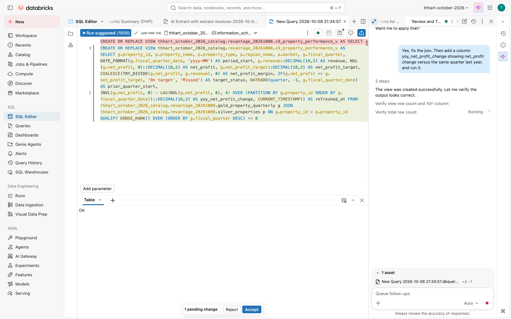

*Genie Code explains the Snowflake view and lists what to change for Databricks SQL.*

### Stage 1: Paste and run (3 min)

Paste the Snowflake view into a new SQL editor tab. Replace the table prefixes with `<catalog>.<schema>`
and the view name with `<my_schema>.property_performance_v`. Run it.

**Expected:** `[UNSUPPORTED_DATATYPE] Unsupported data type "NUMBER(18,2)"`.
**Checkpoint:** the error appears in the results panel.
**If stuck:** check the three-part names. The error must be about `NUMBER`, not "table not found".
**Watch for:** the editor's automatic **Genie Code Quick Fix** pops up an inline "Accept & Run" that only rewrites `::NUMBER` as `CAST(… AS NUMBER(18,2))`, which still fails. Click **Reject** and use the Genie Code chat (Stage 2). A good lesson: one-click fixes are shallow; a conversation migrates.

### Stage 2: Explain and find the issues (5 min)

**Prompt** (Genie Code, SQL editor, with the query selected):
> Explain this query and identify any issues for Databricks SQL. It was written for Snowflake.

**Expected:** Genie Code flags `NUMBER(18,2)` (use `DECIMAL`), `TO_VARCHAR(date, 'YYYY-MM')` (use
`date_format(date, 'yyyy-MM')`), `DIV0` (use `try_divide`), and `SYSDATE()` (use `current_timestamp()`).
It may also note that `NVL`, `IFF`, `DATEADD`, and `QUALIFY` work as-is.
**Checkpoint:** all four incompatibilities are listed.
**If stuck:** ask the follow-up "Which functions in this query don't exist in Databricks SQL?"

### Stage 3: Fix the syntax (5 min)

(In the pre-build run Genie Code already applied all fixes after Stage 2's prompt, plus `IFF` → `IF`, and then **paused for approval** because `CREATE OR REPLACE VIEW` is destructive. Click **Accept all**, then **Run**.)

**Prompt:**
> Fix the syntax errors and adapt this for Databricks SQL. Keep the logic the same.

**Expected:** the view is created. Then run:
`SELECT COUNT(*) FROM <my_schema>.property_performance_v` → **176**.
**Checkpoint:** 176 rows. That's suspicious: 8 properties × 8 quarters should be 64.
**If stuck:** copy the syntax lines from the reference view (`SHOW CREATE TABLE <catalog>.<schema>.ref_d03_property_performance_v`), but keep your join as it is.

### Stage 4: Why are there duplicate rows? (5 min)

**Prompt:**
> Why does this view return 176 rows when there are 8 properties and 8 quarters? Are there duplicate rows?

**Expected:** Genie Code spots the join `ON g.region_name = p.region_name`: each property row matches
every property in its region (3 in Southeast, 2 in Northeast, 3 in Western Europe), and `property_name`
comes from the wrong side of the join. Fix: `ON g.property_id = p.property_id`.
**Checkpoint:** after the fix, `COUNT(*)` = **64** and `COUNT(DISTINCT property_id, fiscal_quarter)` = 64.
**If stuck:** "Compare row counts with and without the join to silver_properties."

### Stage 5: Add YoY (7 min)

**Prompt:**
> Add a column yoy_net_profit_change showing net_profit change versus the same quarter last year.

**Expected:** `net_profit - LAG(net_profit, 4) OVER (PARTITION BY property_id ORDER BY fiscal_quarter)`.
Watch for `LAG(..., 1)`: that's quarter-over-quarter, not YoY. Ask Genie Code "Is that the same quarter last year or the previous quarter?" if it uses 1.
**Checkpoint:**
```sql
SELECT property_name, yoy_net_profit_change FROM <my_schema>.property_performance_v
WHERE fiscal_quarter = '2026-Q2' ORDER BY yoy_net_profit_change LIMIT 1
```
→ **Harbor Tower, −478,309.66**. 2024-Q3 and 2024-Q4 are NULL (no 2023 data).
**If stuck:** compare with the reference view.

### Stage 6: Verify (5 min)

**Prompt:**
> Write a query that checks my view against <catalog>.<schema>.ref_d03_property_performance_v row by row and returns any differences.

**Expected:** an `EXCEPT` or full-outer-join check returning 0 rows (ignore `refreshed_at`).

### Wrap-up

- **So what:** the migration is a conversation. Genie Code found the 4 incompatible functions and a join bug that was already wrong in Snowflake.
- **Snowflake equivalent:** Snowflake Copilot explains and drafts SQL. Genie Code also fixes, runs, and checks against governed tables in the same editor.
- **Verified:** 2026-10-08 on the FEVM workspace, **all stages in the Genie Code UI** (S9): Stage 1 error `UNSUPPORTED_DATATYPE NUMBER(18,2)`; Stage 2 Genie Code listed NUMBER→DECIMAL ×3, TO_VARCHAR→DATE_FORMAT 'yyyy-MM', DIV0→COALESCE(TRY_DIVIDE), IFF→IF, SYSDATE→CURRENT_TIMESTAMP and said NVL/DATEADD/QUALIFY need no change; Stage 3 view = **176** rows; Stage 4 it explained the region fan-out (72 + 72 + 32 = 176) and proposed `property_id`; Stage 5 it reasoned to `LAG(…, 4)` and the view returned **64** rows, Harbor Tower 2026-Q2 YoY **−478,309.66** (identical to the reference); Stage 6 Genie Code read both schemas and wrote a full-outer-join diff on (property_id, fiscal_quarter) with a per-column `differing_columns` list: 0 rows. Screenshots `notes/agent-notes/screenshots/s9-d03-*.png`.

<a id="demo-4"></a>
## Demo 4: Extraction Agent — "Invoice-to-Table"

**Session:** Day 1, 11:00–11:45 (45 min) · **You build:** an Information Extraction agent over the invoices + a Delta table of extracted fields · **Reference:** agent `extract-invoices-2026-10-08-15-39-15` ("Invoice Extractor (Reference)"), table `<catalog>.<schema>.ref_invoices_extracted`
**Starting state:** 8 invoice PDFs in `/Volumes/<catalog>/<schema>/documents/invoices/` (5 vendors' layouts, EUR ×5, USD ×2, GBP ×1); ground truth `code/documents/out/invoices_ground_truth.json`
**Where:** left nav **Agents** → **Create Agent** → **Information Extraction**; then the SQL editor

**Timing reality (measured 2026-10-08):** clicks take ~3 minutes; file parsing + schema generation ~6 minutes;
the first extraction ~2 minutes. Plan ~12 minutes wall-clock from "Create" to results. Start it, then
talk through the platform story while it parses. The agenda's "3–4 minutes" is the clicking, not the waiting.

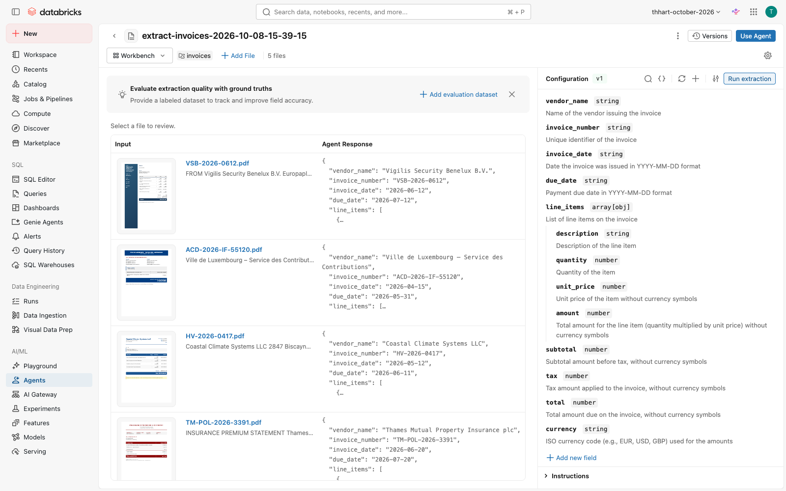

*The Information Extraction agent reads every invoice into typed fields.*

### Stage 1: Create and point at the documents (3 min)

**Agents → Create Agent → Information Extraction → Select volume**. Choose **All volumes**, search
`documents`, click the volume, then expand it and click **invoices** (the breadcrumb must end in
`/documents/invoices`) → **Select**.

**Expected:** "Processing 5 files…"; the build view samples 5 of the 8 invoices.
**If stuck:** if expanding the volume shows "Request access", wait a few seconds and expand again: the folder list loads late.
Don't select the volume root, or the policies and leases get sampled too.

### Stage 2: Describe what to extract (3 min)

**Prompt** (the "Describe what you want to extract" box):
> Extract from each vendor invoice: vendor_name, invoice_number, invoice_date, due_date, line_items (an array where each item has description, quantity, unit_price, amount), subtotal, tax, total, and currency (ISO code like EUR, USD, GBP). Dates as YYYY-MM-DD. Amounts as numbers without currency symbols.

Click **Generate schema**.
**Expected:** the 9 fields, with `line_items` as `array[obj]` of 4 sub-fields.
**Checkpoint (important):** open `line_items › quantity`. Genie generates **integer**; change it to **Number**.
The legal invoice bills 4.5 / 2.5 / 1.5 hours, and integer would truncate them.

### Stage 3: Run and review (5 min)

Click **Run extraction**. Click each file to see the PDF next to the JSON.
**Expected (Coastal Climate Systems, HV-2026-0417):** total **339600**, currency **USD**, 4 line items (chiller 214,500; crane 38,900; installation 61,200; commissioning 25,000), tax null.
Also check the bilingual Luxembourg tax notice (ACD-2026-IF-55120, €27,826.50) and the UK insurance statement (£55,272 incl. 12% IPT).

### Stage 4: Use the agent in production (5 min)

Click **Use Agent**. Show the five paths: **Run in SQL**, Run in Notebook, REST API, **Create a Lakeflow Job**, **Create a Spark Declarative Pipeline**.
Click **Run in SQL → Start extraction**. A SQL editor tab opens with the generated query:
`read_files(..., format => 'binaryFile')` → `ai_parse_document(content, map('version','2.0'))` → `ai_extract(parsed, '<json schema>', options => map('version','2.0'))`.

**Prompt** (Genie Code, in that SQL editor tab):
> Explain this query step by step, then wrap it in CREATE OR REPLACE TABLE <my_schema>.invoices_extracted so the results are saved as a Delta table.

**Expected:** a CTAS over the same query; 8 rows; `response` is a VARIANT with `response.response.<field>`.
**Checkpoint:** `SELECT response:response.invoice_number::string, response:response.total::double FROM <my_schema>.invoices_extracted` → 8 rows incl. `HV-2026-0417 | 339600`.
**If stuck:** run `code/reference/d04_extract_invoices.sql` (the captured agent SQL as a CTAS).

### Stage 5: Reconcile to the GL (6 min)

**Prompt** (Genie Code):
> Join the extracted invoices to <catalog>.<schema>.silver_gl_transactions where the GL description starts with the invoice number, and show invoice total, currency, GL amount in EUR, and the GL account name and category.

**Expected:** HV-2026-0417: USD 339,600 ↔ **€312,390.76** booked to **Repairs & Maintenance (OpEx)**. The others don't
match by invoice number (the GL has monthly accruals). Hold that thought: in Demo 5 the policy says this chiller is **CapEx**.

### Stage 6: Into a pipeline (3 min, show)

Back in the agent: **Use Agent → Create a Spark Declarative Pipeline**. Show that new PDFs dropped into the volume
are extracted incrementally on schedule. Don't run it in the room; it's the production path.

### Wrap-up

- **So what:** an analyst built an invoice extractor without code, verified it against the PDFs, and got production SQL, a job, or a pipeline from the same agent.
- **Snowflake equivalent:** Document AI (model building + `!PREDICT`). On Databricks it's ai_parse_document + ai_extract in SQL, governed in Unity Catalog, with one-click pipelines.
- **Verified:** 2026-10-08 in the browser on the FEVM workspace: agent built from the invoices folder; the reference CTAS over all 8 invoices scored **72/72 fields (100%)** vs ground truth (`code/reference/d04_score_extraction.py`); the GL reconciliation returned the €312,390.76 R&M posting. **Stages 4–5 run in the Genie Code UI (S9)** in the agent's *Run in SQL* tab: S4 explained read_files → ai_parse_document → ai_extract step by step, wrapped it in a CTAS, 8 rows incl. HV-2026-0417 339,600 (it called that "€339,600"; the invoice is USD: point at the currency column); S5 the join returned exactly HV-2026-0417, USD 339,600 ↔ €312,390.76, Repairs & Maintenance (OpEx). Screenshots: `notes/agent-notes/screenshots/d04-*.png`.

<a id="demo-5"></a>
## Demo 5: Knowledge Assistant — "Ask the Policy Book"

**Session:** Day 1, 11:45–12:15 (30 min) · **You build:** a Knowledge Assistant over the group policies · **Reference:** agent `revantage-policy-assistant` (endpoint `ka-234e391f-endpoint` on the FEVM; a new ID in your workspace)
**Starting state:** 4 policy PDFs in `/Volumes/<catalog>/<schema>/documents/policies/` (Expense Approval, Capital Expenditure Guidelines, Lease Renewal Procedures, Intercompany Transfer); ground truth `code/documents/out/policies_qa_ground_truth.md`
**Where:** Agents → Create Agent → Knowledge Assistant

**Timing reality (measured 2026-10-08):** the form takes ~3 minutes; the endpoint and vector index then take
**~15–25 minutes** before the first answer. Until then questions fail with "Vector index … is not ready".
**Start the build at the beginning of Demo 4** (11:00) so it's ready at 11:45, or use the reference agent while yours indexes.

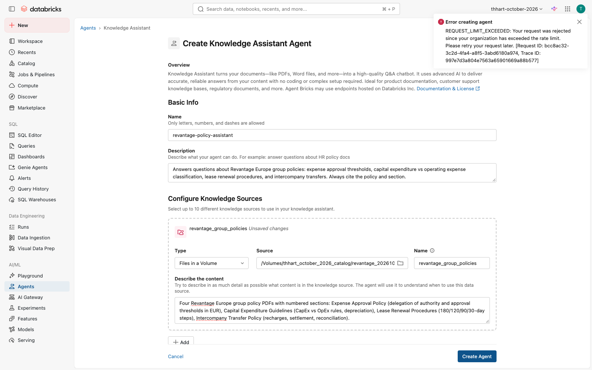

*The Knowledge Assistant indexes the four policy PDFs.*

### Stage 1: Create (3 min, start it early)

**Agents → Create Agent → Knowledge Assistant.**
- **Name:** `policy-assistant-<your_name>` (letters, numbers, dashes; ≤ 64 characters; clear the default name first)
- **Description:**
  > Answers questions about Revantage Europe group policies: expense approval thresholds, capital expenditure vs operating expense classification, lease renewal procedures, and intercompany transfers. Always cite the policy and section.
- **Knowledge source:** Type *Files in a Volume* → Source → *All volumes* → `documents` → expand → **policies** → Select. Name `revantage_group_policies`.
- **Describe the content:**
  > Four Revantage Europe group policy PDFs with numbered sections: Expense Approval Policy (delegation of authority and approval thresholds in EUR), Capital Expenditure Guidelines (CapEx vs OpEx rules, depreciation), Lease Renewal Procedures (180/120/90/30-day steps), Intercompany Transfer Policy (recharges, settlement, reconciliation).

**Create Agent.** **If stuck:** "REQUEST_LIMIT_EXCEEDED" → wait a few seconds and click Create again; if the button spins for minutes, reload, re-enter, and check the agent list first (it may already exist).

### Stage 2: Ask the three business questions (10 min)

In the agent's **Test** panel (or the reference agent while yours indexes):
> What is the approval threshold for expenses over €50,000?

**Expected:** co-signature of the **CFO and the Asset Management Director**, two different people, with supporting documentation. Cites `expense-approval-policy.pdf`.
> If a tenant's lease expires in 90 days, what steps should I take?

**Expected:** Day-90 step: formal written notice by registered letter if there's no response to the renewal proposal, escalate to the Head of Asset Management, start re-letting marketing in parallel; final decision at day 30. Cites `lease-renewal-procedures.pdf`.
> Is a new HVAC system for Harbor Tower classified as CapEx or OpEx?

**Expected:** **CapEx**: replaces a building system, > €25,000, useful life 20 years (> 3); routine servicing would be OpEx. Cites `capital-expenditure-guidelines.pdf`.
**Land it:** Demo 4 showed this exact chiller (HV-2026-0417, €312k) booked to **Repairs & Maintenance (OpEx)**. That's why Harbor Tower "missed" its Q2 target by €43k. The policy says reclassify it.

### Stage 3: Citations and follow-ups (5 min)

Open the citation on each answer: it links to the source PDF passage. Try:
> What credit rating threshold requires Head of Asset Management sign-off for lease renewal?

**Expected:** tenants rated **below BB**.

### Stage 4: Share and use from SQL (7 min)

- **Share:** agent page → Permissions → add the team (Can Query). Anyone with access can use it in the Playground or through the endpoint.
- **From SQL** (the "agents scale to production via SQL" point):
```sql
SELECT ai_query('<your KA endpoint name>',
  'Does invoice HV-2026-0417 (USD 339,600 chiller replacement) need CFO approval? Answer in one sentence.') AS answer
```
**Expected:** "Yes … exceeds the €50,000 threshold that requires co-signature of the CFO and Asset Management Director."
**Prompt** (Genie Code, SQL editor):
> Use ai_query with my Knowledge Assistant endpoint to add a column policy_check to a copy of <catalog>.<schema>.ref_invoices_extracted in <my_schema> that says, for each invoice, which approvers it needs under the Expense Approval Policy.

**Expected (seen in pre-build):** Genie Code pauses for approval of the `CREATE OR REPLACE`, then 8 answers grounded in the policy, and it handles the USD/GBP conversion caveat. But only **6 of 8 are right**: for VSB-2026-0612 (€30,782.40) and PE-2026-06-0088 (USD 41,000 ≈ €37.7k) the Knowledge Assistant quoted the correct €25,000.01–€50,000 row and then named the *Asset Manager* instead of the **Head of Asset Management**.
**Teach (the point of this stage):** check agent output against a deterministic rule before trusting it at scale. For the EUR invoices:
```sql
SELECT response:response.invoice_number::string AS invoice, response:response.total::double AS total,
       CASE WHEN response:response.total::double > 50000 THEN 'CFO + AM Director'
            WHEN response:response.total::double > 25000 THEN 'Head of Asset Management'
            WHEN response:response.total::double > 5000  THEN 'Asset Manager' ELSE 'Property Manager' END AS rule_approver,
       policy_check
FROM <my_schema>.invoices_policy WHERE response:response.currency::string = 'EUR'
```
(USD/GBP need the ECB rate first; Demo 12's `approvals.invoice_approvals.total_eur` has them converted.) Thresholds belong in code (Demo 12 puts `requires_two_approvers` in a generated column); use the agent for the questions code can't answer (CapEx vs OpEx, exceptions, renewals).
**Note:** write the new column into `<my_schema>` (e.g. `CREATE TABLE <my_schema>.invoices_policy AS SELECT …`), not into the shared `ref_` table.

### Stage 5: Tour of other agent types (5 min, show)

In **Create Agent** point out: **Information Extraction** (Demo 4), **Document Parsing**, **Text Classification**,
**Supervisor Agent** (combine Genie Agents, Knowledge Assistants, and MCP tools, e.g. "Portfolio Q&A + Policy Assistant"),
**Knowledge Assistant**, **code your own agent** (Apps template), **Genie Agent**.

### Wrap-up

- **So what:** policies answer themselves, with citations, and the same agent works from chat, SQL, and other agents.
- **Snowflake equivalent:** Cortex Search + Cortex Agents. On Databricks the Knowledge Assistant is built from a volume in minutes, governed in Unity Catalog, and callable from SQL with ai_query.
- **Verified:** 2026-10-08 on the FEVM workspace. Agent built in the browser at 15:54 (first create hit a rate limit); index ready in ~25 min. All 6 ground-truth questions answered correctly with the right PDF cited (`verification/raw/d05-ka-2026-10-08.txt`); `ai_query` from SQL verified. **Stage 4 run in the Genie Code UI (S9)** against a scratch copy of the extracted invoices (since dropped): 8 `ai_query` answers via `ka-234e391f-endpoint`, 6/8 correct as described above (the two errors come from the KA text itself, not from Genie Code's summary).

<a id="demo-6"></a>
## Demo 6: Genie One Data Exploration — "Audit your data before you trust it"

**Session:** Day 1, 12:15–12:30 (15 min) · **You build:** a recurring quality check from Genie's SQL · **Reference:** view `<catalog>.<schema>.ref_d06_property_quality_checks`
**Starting state:** Genie Agent "Revantage Portfolio Q&A (Start)" (includes `bronze_properties`); `silver_properties`, `gold_property_quarterly`
**Where:** Genie One, then SQL editor with Genie Code

Fast-paced: one question per ~2 minutes. After each answer open **Show code**.

### Stage 1: Layer counts (2 min)

**Prompt** (Genie One):
> How many properties are in the bronze layer vs. the gold layer?

**Expected:** bronze **10**, gold **8**.

### Stage 2: What got dropped (2 min)

**Prompt:**
> Which properties exist in bronze but not in gold?

**Expected:** id 9 **Riverside Annex** (Charlotte) and id 10 **Harbor Tower** (Miami Bch), both with no region.

### Stage 3: Completeness (2 min)

**Prompt:**
> Show me the null rate for every column in bronze_properties

**Expected:** `region_id` **20%** (2 of 10). `_rescued_data` 100% NULL: that's Auto Loader's column for
values that didn't fit the schema, and all-NULL is good news.

### Stage 4: Duplicates (2 min)

**Prompt:**
> Are there any duplicate property names with different IDs?

**Expected:** **Harbor Tower**, ids **3** and **10**. Id 10 is the bad record from Stage 2.

### Stage 5: Cross-source consistency (2 min)

**Prompt:**
> Compare market names between bronze and silver for mismatches

**Expected:** 3: Miami Bch → Miami Beach, NYC → New York, Lux-Ville → Luxembourg City.

### Stage 6: Keep the checks (5 min)

Copy the SQL from Stages 1–5 (Show code → copy) into a SQL editor tab, then:

**Prompt** (Genie Code, SQL editor):
> Combine these five checks into one view <my_schema>.property_quality_checks with columns check_name, observed, issue_count, one row per check.

**Expected:** a view returning 5 rows with issue counts **2, 2, 2, 1, 3**.
**Checkpoint:** `SELECT * FROM <my_schema>.property_quality_checks` matches `SELECT * FROM <catalog>.<schema>.ref_d06_property_quality_checks`.
**If stuck:** `SHOW CREATE TABLE <catalog>.<schema>.ref_d06_property_quality_checks` and copy it.
Teaser for Demo 16: schedule this view as an alert so the next bad load is caught automatically.

### Wrap-up

- **So what:** a 15-minute conversation found every planted issue and produced a reusable check, without writing SQL by hand.
- **Verified:** 2026-10-08. Stages 1–5 via the Genie Conversation API (`verification/d02-d06-d07-genie.md`, raw transcript `verification/raw/d06-genie-start-2026-10-08.txt`); reference view returns 2, 2, 2, 1, 3. **Stage 6 run in the Genie Code UI (S9)** with the five checks described in words (scratch view, since dropped): Genie Code read the three schemas, wrote a 5-branch UNION ALL view and returned issue counts **2, 2, 2, 1, 3**, identical to the reference. If participants paste their Stage 1–5 SQL instead, the result should be the same.

<a id="demo-7"></a>
## Demo 7: Semantic Layer & UC Metric Views — "Define Net Profit Margin once"

**Session:** Day 1, 1:30–2:15 (45 min) · **You build:** three metric views in `<my_schema>` · **Reference:** `<catalog>.<schema>.ref_mv_net_profit_margin`, `ref_mv_target_attainment`, `ref_mv_qoq_revenue_growth` (source `code/reference/d07_metric_views.sql`)
**Starting state:** `gold_property_quarterly` with revenue, operating_expense, mgmt_fee, capex, intercompany, net_profit (Finance), targets
**Where:** SQL editor with Genie Code; Catalog Explorer; Genie One

The story: Finance's net profit = revenue − opex − management fees. Asset Management also subtracts capex.
Same portfolio, two "net profit margins": **59.3% vs 54.0%** in 2026-Q2. A metric view puts the approved one in the catalog.

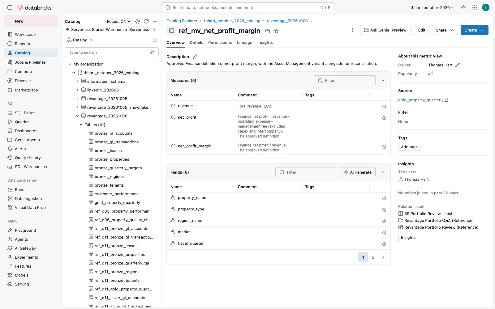

*The approved net profit margin as a Unity Catalog metric view, with its measures documented.*

### Stage 1: Net profit margin (12 min)

**Prompt** (Genie Code, SQL editor):
> Create a Unity Catalog metric view <my_schema>.mv_net_profit_margin over <catalog>.<schema>.gold_property_quarterly with dimensions property_name, property_type, region_name, market, fiscal_quarter, fiscal_quarter_date and measures revenue = SUM(revenue), net_profit = SUM(net_profit), net_profit_margin = SUM(net_profit) / SUM(revenue), plus asset_mgmt_net_profit_margin = SUM(net_profit - capex) / SUM(revenue) labelled as not approved.

**Expected:** `CREATE OR REPLACE VIEW … WITH METRICS LANGUAGE YAML AS $$ version: 1.1 … $$`. (Metric views are views with a YAML body; there is no `CREATE METRIC TABLE`.)
**Checkpoint:**
```sql
SELECT MEASURE(net_profit_margin), MEASURE(asset_mgmt_net_profit_margin)
FROM <my_schema>.mv_net_profit_margin WHERE fiscal_quarter = '2026-Q2'
```
→ **0.5933 · 0.5395**. By region: `GROUP BY region_name`.
**If stuck:** copy the first statement of `code/reference/d07_metric_views.sql`, change the view name.
**Teach:** ratios belong in measures (`SUM/SUM`), never as a stored column: the margin re-aggregates correctly at any grouping.

### Stage 2: Target attainment (8 min)

> Add a metric view mv_target_attainment with measures properties = COUNT(DISTINCT property_id), properties_met_target = COUNT(DISTINCT property_id) FILTER (WHERE met_target), target_attainment = their ratio, and net_profit_vs_target = SUM(net_profit) - SUM(net_profit_target). Format amounts as EUR.

**Checkpoint (2026-Q2):** properties **8**, met **5**, attainment **0.625**; (Without "Format amounts as EUR" Genie Code tends to add a USD format.) `GROUP BY property_name HAVING MEASURE(net_profit_vs_target) < 0` → Peachtree Center −71,293; Harbor Tower −43,235; Zuidas Residences −41,701.

### Stage 3: QoQ growth (10 min)

> Add mv_qoq_revenue_growth whose source is a query adding prior_quarter_revenue = LAG(revenue) per property, with measures qoq_revenue_growth = SUM(revenue) / SUM(prior_quarter_revenue) - 1 and qoq_net_profit_growth using prior_quarter_net_profit.

**Checkpoint (2026-Q2, by market):** `qoq_net_profit_growth`: Luxembourg City **+10.0%** (highest), Miami Beach **−44.1%**; by region Southeast **−18.6%** (the Demo 2 Genie numbers). `qoq_revenue_growth` is smaller: Luxembourg City +9.2%, Miami Beach −17.6%, Southeast −6.4%. Make sure participants compare the right measure.
**Teach:** compute "prior" in the source; then growth is correct for any grouping (property, market, region, portfolio).

### Stage 4: Govern it (5 min)

Catalog Explorer → your metric view → owner, comment, **Certified** tag (`system.certification_status`), grants. Point out lineage back to gold.

### Stage 5: Genie answers from the definition (10 min)

In Genie One open **Revantage Portfolio Q&A (Reference)** (it includes the `ref_mv_*` views):
> Which properties missed their quarterly target in 2026-Q2?

**Expected:** the same 3 properties, answered from `ref_mv_target_attainment` (net_profit_vs_target). The answer names the metric view.
> What is our net profit margin this quarter, and how would it differ under the Asset Management definition?

**Expected:** 59.33% vs 53.95% (−5.38 pp), labelled as the approved vs the non-approved definition.

### Wrap-up

- **So what:** the KPI argument happens once, in the catalog, and every dashboard, Genie answer, and query uses that answer.
- **Snowflake equivalent:** semantic views in Snowflake. UC metric views are queried with plain SQL (`MEASURE()`), used natively by AI/BI dashboards and Genie, and governed like any table.
- **Verified:** 2026-10-08 on the FEVM workspace: reference views created and every checkpoint number above returned by SQL; the Genie Stage 5 answers via the Conversation API (`verification/d02-d06-d07-genie.md`). **Stage 1 run in the Genie Code UI (S9):** Genie Code loaded its metric-view skill, wrote valid YAML 1.1 DDL (4 measures, no join), ran it and the query, and reported 59.33% / 53.95% with the capex explanation; the view it created returned 0.5933 / 0.5395. **Stages 2–3 run in the Genie Code UI (S9):** S2 view returned 8 / 5 / 0.625 and the 3 shortfalls (−71,293.16 / −43,234.95 / −41,701.20), formatted as USD; S3 Genie Code put `LAG` in the source and its view matched `ref_mv_qoq_revenue_growth` on every market for both measures.

<a id="demo-8"></a>
## Demo 8: AI/BI Dashboards — "Executive Portfolio Review"

**Session:** Day 1, 2:15–3:15 (60 min) · **You build:** dashboard "Portfolio Review – <your_name>" · **Reference:** "Revantage Portfolio Review (Reference)"
**Starting state:** metric views `ref_mv_net_profit_margin`, `ref_mv_target_attainment`, `ref_mv_qoq_revenue_growth` (or your own from Demo 7), `gold_property_quarterly`, `ref_d14_revenue_forecast`
**Where:** Dashboards → Create dashboard; Genie Code panel in the dashboard editor


*The Executive Summary page: €10.7M revenue, 59.3% margin, 62.5% target attainment.*

### Stage 1: Create and add data (5 min)

Dashboards → **Create dashboard** → rename "Portfolio Review – <your_name>". **Data** tab → **Add data source** →
pick `ref_mv_net_profit_margin`, `ref_mv_target_attainment`, `gold_property_quarterly`.

**Prompt** (Genie Code, dashboard editor):
> Add a dataset kpi_latest that returns, for fiscal_quarter 2026-Q2, revenue, net profit and net profit margin from ref_mv_net_profit_margin and target attainment from ref_mv_target_attainment, one row. Metric views can't be joined: aggregate each with MEASURE() in its own subquery and cross join the two results. Run the dataset and check it.

**Expected:** one row: revenue 10,744,919; net_profit 6,375,345; margin 0.5933; target_attainment 0.625.
**Watch for (seen in pre-build):** without the MEASURE()/subquery sentence Genie Code joined the two metric views `ON 1 = 1` and said "created" without running it; the dataset fails with `METRIC_VIEW_JOIN_NOT_SUPPORTED`. Teach: always ask Genie Code to run and check what it builds.
**If stuck:** copy the `kpi_latest` query from the reference dashboard (open it → Data tab).

### Stage 2: Page 1, Executive Summary (10 min)

**Prompt:**
> On a page "Executive Summary", add counters for Revenue 2026-Q2 (EUR, compact), Net profit margin (%), and Target attainment (%) from kpi_latest, and a line chart of net profit by fiscal_quarter colored by region_name from ref_mv_net_profit_margin.

**Expected:** €10.7M · 59.3% · 62.5%; the line chart shows Southeast dropping in 2026-Q2.
**Checkpoint:** the counters match the reference dashboard's Executive Summary.

### Stage 3: Page 2, Regional Performance (12 min)

**Prompt:**
> Add a page "Regional Performance" with a bar chart of net profit by region and a scatter of revenue vs revenue_target by property, both from one dataset on gold_property_quarterly, and a heatmap of quarter-over-quarter net profit growth by market and quarter from ref_mv_qoq_revenue_growth. Add a single-select fiscal_quarter filter defaulting to 2026-Q2 that applies to the bar and scatter.

**Expected:** bar (2026-Q2): Western Europe highest, Southeast **€2,094,950**; heatmap: Miami Beach 2026-Q2 is the darkest negative cell (−44%), Luxembourg City +10%.
**Checkpoint:** if the bar shows ~€24.5M for Southeast, it isn't filtered (all 10 quarters summed): the filter only binds to datasets it was created on. Ask: "Make the Fiscal Quarter filter apply to the bar too, and check the 2026-Q2 Southeast value." Without "from gold_property_quarterly" Genie Code looks only in the metric views, can't find revenue_target, and substitutes net_profit.
**If stuck:** switch the widget type in the widget panel; Genie Code sometimes picks a table first.

### Stage 4: Page 3, Exceptions & Risks (8 min)

**Prompt:**
> Add a page "Exceptions & Risks" with a table of properties from gold_property_quarterly showing net profit, target, variance (net_profit - net_profit_target), qoq_change_pct (already in percent units, -44.05 means -44.05%) and a flag "Sharp decline" when qoq_change_pct < -10, with filters for fiscal_quarter (default 2026-Q2) and met_target.

**Expected:** filtering met_target = false gives 3 rows: Peachtree Center −€71,293, Harbor Tower −€43,235 (Sharp decline, −44%), Zuidas Residences −€41,701.

### Stage 5: Global filters (5 min)

**Prompt:**
> Add global filters for region_name and property_type that apply to all pages. Bind them to every dataset that has those columns, then set Region = Western Europe and verify each page.

**Checkpoint:** Region = Western Europe: the bar shows one bar (€2.69M), the Exceptions table 3 properties, the heatmap 2 markets. The three counters don't change: `kpi_latest` is a one-row portfolio dataset (a good talking point: which KPIs should be filterable?).
**Watch for (seen in pre-build):** with the short prompt Genie Code bound the filters to one dataset and still said they apply to all pages; Exceptions kept showing 8 rows. A filter only applies to the datasets listed in its fields.

### Stage 6: Ask Genie on the dashboard (8 min)

**Publish** the dashboard. In the published view use the **Ask Genie** bar at the bottom (or select a chart, then ask about it):
> Why did Southeast net profit drop in Q2?

**Expected:** Genie drills down by property type, then property: **Harbor Tower** net profit €1.15M → €0.64M (−44%) while revenue fell only 18%, so a cost spike sits on top of the revenue loss. Other Southeast properties were flat or up.
Follow-up for Demo 5: "What made Harbor Tower's operating expense jump?" → repairs & maintenance (the chiller invoice HV-2026-0417).

### Stage 7: Share, schedule, cache (5 min)

- **Share** → add the `revantage_consumers` group as *Can view* (viewers use the publisher's or their own credentials, as you choose).
- **Schedule** → daily 07:00 refresh + email snapshot to yourself.
- Explain caching: published dashboards serve cached results, refreshed on schedule or on demand.
- Talk track: Tableau/Power BI import, custom visuals, and embedding are available; show only if enabled in the workspace (pre-flight).

### Stage 8 (optional, with Demo 14): Forecast page

**Prompt:**
> Add a page "Forecast" with a line chart from ref_d14_revenue_forecast showing actual, forecast, lower and upper interval and target over fiscal_quarter_date for one property, with a property filter defaulting to Harbor Tower.

### Wrap-up

- **So what:** the quarterly review pack is a live, governed dashboard with Genie for the follow-up questions. No Excel, no emailed PDFs.
- **Snowflake equivalent:** Snowsight dashboards are SQL tiles. AI/BI adds a semantic layer (metric views), Genie Q&A, and publishing/sharing on the same governed data.
- **Verified:** 2026-10-08 on the FEVM workspace. The reference dashboard renders all 4 pages with correct numbers (screenshots `notes/agent-notes/screenshots/d08-*.png`). The dashboard Genie answered the Southeast question correctly in the browser. **Stages 1–5 and 8 run in the dashboard editor's Genie Code (S9)** on a scratch dashboard: S1 one row 10,744,918.88 / 6,375,345.36 / 0.5933 / 0.625 (first-time right with the prompt above; the original prompt produced a failing join); S2 counters €10.7M · 59.3% · 62.5% and the line chart with the Southeast drop (Genie Code fixed its own `METRIC_VIEW_MISSING_MEASURE_FUNCTION` error); S3 needed the two follow-ups now baked into the prompt/checkpoint, then Southeast €2,094,949.91 and the heatmap Miami Beach −44%; S4 8 rows, Harbor Tower "Sharp decline", variances −71.3K/−43.2K/−41.7K; S5 after the binding follow-up every page filters; S8 Harbor Tower actual + forecast + interval + target (the Forecast page didn't pick up the global filters). Screenshots `s9-d08-*.png`. Stage 6–7 (Ask Genie, share/schedule) are UI clicks, not Genie Code prompts.

<a id="demo-9"></a>
## Demo 9: Databricks Apps — "Lease Expiry Tracker"

**Session:** Day 1, 3:30–4:15 (45 min) · **You build:** a lease-expiry quick tool as a Databricks App · **Reference:** app `revantage-lease-tracker` (Next.js + TypeScript, `code/app/`)
**Starting state:** `silver_leases` (50), `silver_tenants` (40), `silver_properties` (8); a SQL warehouse; the reference app deployed and shared
**Where:** Apps (new Apps UI: **New → App**), the app's source folder in the workspace with Genie Code

Expected numbers (live, from `current_date()`; as of 2026-10-13 the planted windows are 4 expired · 6 ≤ 90 d · 8 more ≤ 180 d · 10 more ≤ 365 d):
on 2026-10-08 the reference app shows **6 / 14 / 23** leases in the 90 / 180 / 365-day windows and 50 incl. expired; 90-day monthly rent at risk **€103k**.

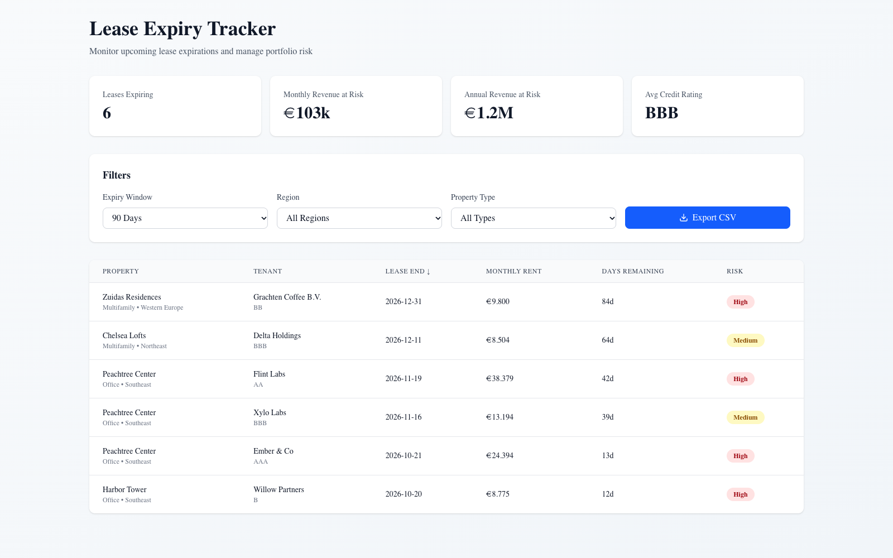

*The lease expiry tracker: windows, risk, rent at risk, CSV export.*

### Stage 1: Start from a template (5 min)

**New → App → Install from templates → Hello world → Streamlit**. Name `lease-tracker-<your_name>`, Create. Wait for **Running** (~2–3 min), open it.
The hello-world create flow only asks for compute, so add the warehouse afterwards: app page → **Edit → App resources → Add resource → SQL warehouse** (Can use), resource key **`sql-warehouse`**, Save.
**Checkpoint:** the template renders. Open **Edit in workspace** to see the source folder.

### Stage 2: Query the leases (10 min)

Open the app's main file (e.g. `app.py`) and Genie Code:
> The app has a SQL warehouse resource named sql-warehouse; in app.yaml read it into DATABRICKS_WAREHOUSE_ID with valueFrom: sql-warehouse (no resources block in app.yaml). Change this app to query <catalog>.<schema>.silver_leases joined to silver_tenants and silver_properties through that warehouse, and show property, tenant, lease end, monthly rent, and days remaining (datediff from current_date) for leases ending in the next 90 days, sorted by days remaining.

**Expected:** a table with 6 rows (today), earliest Harbor Tower / Willow Partners (11 days on 9 Oct; the count is from `current_date`).
**Watch for (seen in pre-build):** without the first sentence Genie Code wrote `valueFrom: resources.sql_warehouse.id` plus a `resources:` block in app.yaml; the app deployed but showed "No SQL warehouse configured". One follow-up naming `sql-warehouse` fixed it.
**Checkpoint:** redeploy (**Deploy**) and refresh. Grant your app's service principal `USE CATALOG` + `USE SCHEMA` + `SELECT` if it errors with permission denied (the facilitator can run it for everyone).
**If stuck:** open the reference app and compare its query: `code/app/src/app/api/leases/route.ts`.

### Stage 3: Filters and risk (10 min)

> Add filters for expiry window (90 / 180 / 365 days / all including expired), region, and property type, and a risk column: High if within 90 days and not 'Pending Renewal' or the tenant's credit rating is below BB; Medium if within 180 days; otherwise Low.

**Expected:** 180-day window → 14 rows; Southeast filter shows Peachtree Center and Harbor Tower leases.
Watch for: the forward windows must exclude leases that have already expired (the reference app had this bug in pre-build).

### Stage 4: Summary cards and export (8 min)

> Add summary cards at the top: number of leases expiring in the window, monthly and annualised rent at risk in EUR, and the average credit rating of the tenants. Add a button that downloads the filtered table as CSV.

**Expected (90 days):** 6 leases · €103k / month · €1.2M / year · average rating BBB (Genie Code's version showed **BBB+**: it rounds the averaged rating scale differently; either is fine, discuss the method).

### Stage 5: Share it like a Google Doc (5 min)

App page → **Permissions** → add `revantage_consumers` (Can use). Send the URL. Viewers sign in with their
Databricks identity; the app reads data as its service principal (or, with on-behalf-of-user auth enabled, as the viewer, so UC row filters and masks apply).
Show where the app is listed for business users: the app list and Genie One's **Discover** page (facilitator show-item: check it in the Revantage workspace pre-flight).

### Stage 6: Talk track (7 min)

- **When an app instead of a dashboard:** workflows (sort, flag, export, write back). Demo 12 adds approve/reject writes on Lakebase.
- **Embedding Genie and agents:** apps can call a Genie Agent (Conversation API) or the Knowledge Assistant endpoint (Demo 5), or use Databricks-managed MCP servers for Genie, UC functions, and vector search.
- **Row Zero / spreadsheet-style analytics:** UNVERIFIED in the Databricks context. Confirm with the account team before mentioning it. Don't present it as a Databricks feature without confirmation.
- **No per-seat cost:** apps bill compute (shown on the create page: Medium ≈ 0.5 DBU/hour), not users.

### Wrap-up

- **So what:** an always-current lease tool on governed data, shared with a link, with no separate hosting stack and no per-seat licences.
- **Verified:** 2026-10-08 on the FEVM workspace: reference app deployed (`databricks bundle run demo_app`), 27 Playwright tests pass locally (filters, sort, cards, export, live-data match, no-expired-in-window); deployed API returns 6 / 14 / 23 / 50 for the four windows, checked in the browser (`notes/agent-notes/screenshots/d09-app.png`). **Template → Genie Code path (Stages 1–4) run in the UI (S9)** on a scratch Streamlit app (deleted afterwards, grants revoked): S1 Running in ~3 min; S2 6 rows after the warehouse-wiring follow-up (now in the prompt); S3 filters + risk, 90 d → 6 (4 High), 180 d → 14, expired excluded from forward windows; S4 cards 6 · €103,046.05 · €1,236,552.60 · BBB+ and a working Download CSV button. Screenshots `s9-d09-template-app*.png`.

<a id="demo-10"></a>
## Demo 10: Unity Catalog & Governance — "Who can see what, and why?"

**Session:** Day 1, 4:15–4:45 (30 min) · **You build:** business metadata, a certification, and PII masks on the gold layer · **Reference:** `code/reference/d10_governance.sql` (apply) and `d10_reset.sql` (back to the starting state)
**Starting state:** `gold_property_quarterly` ships with **no table description** and **no comments** on `net_profit`, `met_target`, `qoq_change_pct`; `customer_performance` has unmasked tenant emails and phones
**Where:** Catalog Explorer, SQL editor with Genie Code

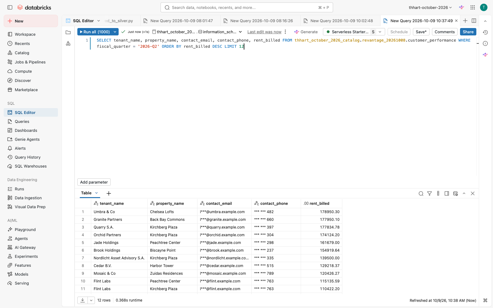

*With the masks applied, a non-steward sees l***@domain and only the last 3 phone digits.*

### Stage 1: Look before you touch (5 min)

Catalog → `<catalog>` → `<schema>` → `gold_property_quarterly`: **Overview** (owner, no description), **Details**, **Permissions**, **Lineage** (upstream silver tables, downstream metric views, the Portfolio Review dashboard, the Genie Agents).

### Stage 2: Describe it for business users (8 min)

In Catalog Explorer use **AI generate** on the description, or in the SQL editor:
**Prompt** (Genie Code):
> Write a description for <catalog>.<schema>.gold_property_quarterly suitable for a non-technical business user, and column comments for net_profit, met_target and qoq_change_pct. Give me the SQL to apply them, run it, and confirm with DESCRIBE TABLE EXTENDED.

**Expected:** `COMMENT ON TABLE … IS '…'` and `ALTER TABLE … ALTER COLUMN net_profit COMMENT '…'` (not TBLPROPERTIES). Net profit must say: revenue minus operating expenses minus management fees; capex and intercompany not deducted.
**Checkpoint:** `DESCRIBE TABLE EXTENDED <catalog>.<schema>.gold_property_quarterly` shows the comment; Genie answers improve because it reads these.

### Stage 3: Certify it (3 min)

```sql
ALTER TABLE <catalog>.<schema>.gold_property_quarterly SET TAGS ('system.certification_status' = 'certified');
```
**Expected:** a **Certified** badge in Catalog Explorer and search. Free-form keys like `data_owner` may be blocked by a governed tag policy ("not an allowed value"); that's governance working.

### Stage 4: Mask PII (8 min)

**Prompt:**
> Create a column mask function that shows the full email only to members of revantage_finance_stewards and otherwise the first letter plus the domain, a similar one for phone numbers showing only the last 3 digits, and apply them to contact_email and contact_phone on <catalog>.<schema>.customer_performance. Put the functions in <my_schema>. Tag the columns with the governed tags class.email_address and class.phone_number. Run it and show me what I see now.

**Expected:** two SQL UDFs with `is_account_group_member(...)`, `ALTER TABLE … ALTER COLUMN contact_email SET MASK …`, tags `class.email_address` / `class.phone_number`.
**Watch for (seen in pre-build):** with "tag with the PII classes" Genie Code chose the account's governed `pii` key, got `UC_TAG_POLICY_VALUE_NOT_ALLOWED … Allowed values: [ssn, address]`, and proposed **extending the tag policy**. Stop it: tag policies are account-level, owned by the governance team, and participants shouldn't change them. Naming `class.email_address` / `class.phone_number` avoids it. Good governance talking point.
**Checkpoint:** `SELECT contact_email, contact_phone FROM <catalog>.<schema>.customer_performance LIMIT 1` → `l***@nimbus.example.com | *** *** 597` for you (you're not in the stewards group).

### Stage 5: Permissions and sharing (4 min)

**Permissions** tab: SELECT for `revantage_consumers` inherited from the schema; `SHOW GRANTS ON TABLE …`. The same group has CAN_RUN on the Genie Agents and CAN_READ on the dashboard, so permissions follow the data. Mention the AI Gateway (Demo 13): model access is governed in the same place.

### 6. Reset (facilitator, after the session)

Run `code/reference/d10_reset.sql`: removes the description, the 3 comments, the tags, and the masks, so the next group starts clean.

### Wrap-up

- **So what:** governance is in the product: descriptions make Genie smarter, certification tells people what to trust, and masks follow the data everywhere it's used.
- **Snowflake equivalent:** object tagging, masking policies, and data classification. UC applies them uniformly across tables, dashboards, Genie, apps, and AI, with lineage.
- **Verified:** 2026-10-08 on the FEVM workspace: reference apply → comments, certified tag, PII class tags, masks (`l***@nimbus.example.com`, `*** *** 597`) confirmed via information_schema and a query; reset → all removed, unmasked values back (`code/tests/check_d10.py`). **Stages 2 and 4 run in the Genie Code UI (S9):** S2 business-friendly description + 3 comments (net_profit correctly "capex and intercompany excluded"); it first ran the wrong statement in a long query tab, noticed via DESCRIBE that nothing applied, and re-ran directly (use a clean query tab). S4 two mask UDFs with `is_account_group_member('revantage_finance_stewards')`, masks applied (`l***@nimbus.example.com`, `***597`); tagging failed on the `pii` policy as described above (stopped before any policy change; policy verified unchanged). Reset run afterwards; starting-state check ALL PASS.

<a id="demo-11"></a>
## Demo 11: Lakeflow — "Bronze-Silver-Gold in 20 minutes"

**Session:** Day 2, 9:30–10:30 (60 min) · **You build:** a Lakeflow Spark Declarative Pipeline from the raw CSVs into `<my_schema>` · **Reference:** pipeline "[Revantage workshop] Property Pipeline (Reference)", tables `<catalog>.<schema>.ref_d11_*`, source `code/pipelines/ref_property_pipeline/`
**Starting state:** 7 CSVs in `/Volumes/<catalog>/<schema>/raw/` (regions, properties, tenants, leases, gl_accounts, gl_transactions, quarterly_targets); oracle `gold_property_quarterly`
**Where:** Jobs & Pipelines → Create → ETL pipeline (Lakeflow Pipelines Editor), Genie Code in Agent mode

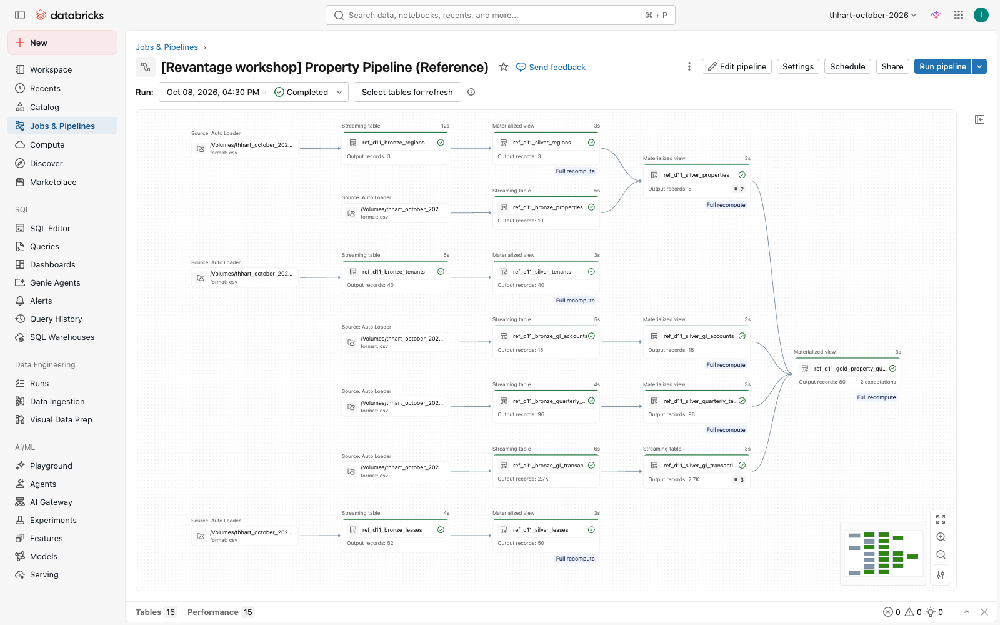

*The reference pipeline graph: 7 Auto Loader sources → bronze → silver → gold.*

### Stage 0: Show, don't build (5 min)

- **Lakeflow Connect:** Data Ingestion → show the connector tiles (Salesforce, Workday, SQL Server, SharePoint…): authenticate once, pick objects, schedule. Revantage's Yardi/SAP extracts land as files today, so we use Auto Loader.
- **Lakeflow Designer / Visual Data Prep:** left nav *Visual Data Prep*: drag-and-drop for analysts; it generates the same pipeline code.

### Stage 1: Create the pipeline and ask for a design (8 min)

Create an ETL pipeline named `property-pipeline-<your_name>`, default catalog `<catalog>`, schema `<my_schema>`, SQL. Open Genie Code (Agent mode):
> I have raw CSV files in /Volumes/<catalog>/<schema>/raw/ for regions, properties, tenants, leases, gl_accounts, gl_transactions and quarterly_targets. Design a Bronze → Silver → Gold Lakeflow Declarative Pipeline in SQL. Bronze: Auto Loader streaming tables with read_files; more files will arrive for each entity, so match <entity>*.csv (for example gl_transactions*.csv), and read gl_transactions.amount as STRING. Silver: typed and cleaned, latest lease version per lease_id by updated_at, properties without a region removed, market names standardized (Miami Bch → Miami Beach, NYC → New York, Lux-Ville → Luxembourg City). Gold: a materialized view gold_property_quarterly with revenue, operating_expense, mgmt_fee, capex, intercompany by property and fiscal quarter, net_profit = revenue - operating_expense - mgmt_fee, joined to quarterly_targets, with met_target and qoq_change_pct. Dry-run it, run it, and check the gold output.

**Expected:** Genie Code proposes 3 files (bronze / silver / gold) with `CREATE OR REFRESH STREAMING TABLE … FROM STREAM read_files(...)` and `CREATE OR REFRESH MATERIALIZED VIEW`. Accept.
**Watch for (seen in pre-build):** Genie Code samples each CSV, writes the files, dry-runs, fixes its own errors (it first pointed `read_files` at single files: "Input path … regions.csv is not a directory"), then runs. Without the `<entity>*.csv` sentence it used `pathGlobFilter => 'gl_transactions.csv'`, which silently ignores the Stage 5 late batch, so nothing fails. Without the STRING sentence it infers `amount` as DOUBLE (see Stage 2).
**If stuck:** copy the three files from `code/pipelines/ref_property_pipeline/` and replace `${raw_path}` with your raw path.

### Stage 2: Bronze (5 min)

**Checkpoint:** every bronze table reads `<entity>*.csv` (either `read_files('<raw path>/<entity>*.csv', …)` or the raw folder plus `pathGlobFilter => '<entity>*.csv'`, both work), and `amount` is STRING in `DESCRIBE <my_schema>.bronze_gl_transactions`.
**Teach:** keep `amount` as **STRING** in bronze (`schemaHints => '... amount STRING ...'`). Stage 6 shows why.

### Stage 3: Expectations (7 min)

**Prompt:**
> Make sure amount is STRING in bronze and try_cast to DECIMAL(18,2) in silver. Add data quality expectations: on silver gl_transactions drop rows whose fiscal_period doesn't match YYYY-Qn and fail the update if amount is NULL after casting; on silver properties drop rows without a region; on gold expect revenue IS NOT NULL and fiscal_quarter in YYYY-Qn format. Run the pipeline with a full refresh and report the expectation metrics.

**Expected:**
```sql
CONSTRAINT valid_fiscal_period EXPECT (fiscal_period RLIKE '^[0-9]{4}-Q[1-4]$') ON VIOLATION DROP ROW,
CONSTRAINT amount_parsed EXPECT (amount IS NOT NULL) ON VIOLATION FAIL UPDATE
```
(the agenda's `MATCHES` isn't SQL; `RLIKE` is), with `try_cast(amount AS DECIMAL(18,2))` in silver.
**Note:** if bronze `amount` changed from DOUBLE to STRING, a normal update fails with `CANNOT_UPDATE_TABLE_SCHEMA`; that's why the prompt asks for a full refresh (Genie Code explains this itself).

### Stage 4: Run and inspect (10 min)

Click **Run pipeline**. Open the **graph**: 7 bronze → silver → 1 gold.
**Expected** (data quality tab): `valid_fiscal_period` **3 failed** (a zero-sum manual accrual with period "2026Q2"); `has_region` **2 failed** (Riverside Annex, the duplicate Harbor Tower); gold **80 rows**.
**Checkpoint:**
```sql
SELECT COUNT(*) FROM <my_schema>.gold_property_quarterly g
JOIN <catalog>.<schema>.gold_property_quarterly r USING (property_id, fiscal_quarter)
WHERE abs(g.net_profit - r.net_profit) > 0.01      -- expect 0
```

### Stage 5: A late batch arrives (facilitator, 2 min)

Facilitator runs `scripts/d11_bad_batch.sh inject <profile> <catalog> <schema>`: it drops
`gl_transactions_late_batch_lux.csv` (3 rows from SAP-LUX, amounts like `"1.850,75"`) into the raw volume. Everyone clicks **Run pipeline** again.

**Expected:** the update **fails**: `EXPECTATION_VIOLATION … Violated expectations: 'amount_parsed' … "amount":"1.850,75" … source_file …/gl_transactions_late_batch_lux.csv`.

### Stage 6: Diagnose and fix with Genie Code (10 min)

**Prompt** (Genie Code, on the failed update):
> Why did this pipeline update fail? Show me the offending rows and propose a fix.

**Expected:** Genie Code points at `amount_parsed` and the European decimal format. A good fix in silver:
```sql
CASE WHEN amount RLIKE ',[0-9]{1,2}$' THEN CAST(replace(replace(amount, '.', ''), ',', '.') AS DECIMAL(18,2))
     ELSE try_cast(amount AS DECIMAL(18,2)) END AS amount
```
(verified: `1.850,75` → 1850.75, `980,40` → 980.40, `258689.5` unchanged).
**The lesson:** during pre-build we first read `amount` as DECIMAL in bronze. The CSV reader silently turned
`"980,40"` into **98,040.00** and `"1.850,75"` into **1.85**, with no error and no rescued data.
The string-in-bronze + expectation pattern is what caught it.

### Stage 7: Clean up (facilitator, 3 min)

`scripts/d11_bad_batch.sh remove …`, then **Full refresh all** (streaming tables keep already-ingested rows until a full refresh).
Note: production-mode pipelines retry failed updates automatically, so expect several failed retries in the history until the fix or removal lands.

### Wrap-up

- **So what:** a governed bronze-silver-gold pipeline from a paragraph of requirements, with quality rules that stop bad money from reaching the board pack.
- **Snowflake equivalent:** Snowpipe + Streams + Tasks + dynamic tables, stitched together. Lakeflow is one declarative pipeline with lineage, expectations, retries, and monitoring built in.
- **Verified:** 2026-10-08 on the FEVM workspace: reference pipeline gold = oracle (80 rows, all numeric columns exact, `code/tests/check_ref_pipeline.py`); expectation metrics as above; inject → FAILED with the message shown → remove → full refresh → COMPLETED and oracle match again. **Stages 1, 3, 5 run with Genie Code in the pipeline editor (S9)** on a scratch pipeline with `s9_` table names: S1 Genie Code sampled all 7 CSVs, wrote bronze/silver/gold, self-fixed a dry-run error and ran it; its gold matched the oracle on all 80 rows (net_profit, revenue, met_target, qoq_change_pct; plus the 2026Q2 junk row before Stage 3); S3 metrics exactly `valid_fiscal_period` 2,693/3, `amount_not_null` 0 failed, `has_region` 8/2, gold 80; S5 (after the glob fix now in the S1 prompt) update FAILED with `EXPECTATION_VIOLATION … 'amount_not_null' … "amount":"1.850,75" … SAP-LUX`. S6 Genie Code read the failed update's events, named `amount_not_null`, listed all 3 SAP-LUX rows with raw and expected values (1.850,75 → 1850.75; 2.410,00 → 2410.00; 980,40 → 980.40) and proposed `CASE WHEN amount LIKE '%,%' THEN replace(replace(amount,'.',''),',','.') …`; on "apply the fix and run" it dry-ran, ran, and the 3 rows landed correctly in silver. Scratch pipeline and `s9_*` tables deleted afterwards.

<a id="demo-12"></a>
## Demo 12: Lakebase & Production Operations — "Approval workflow state machine"

**Session:** Day 2, 10:45–11:30 (45 min) · **You build:** an approval table in Lakebase, approvals through an app, and a job that loads only approved invoices to Delta · **Reference:** Lakebase instance `revantage-lux-ops` (db `revantage_ops`, schema `approvals`), app `revantage-invoice-approvals`, job "[Revantage workshop] Approved invoices -> silver (Reference)", Delta `silver_invoices`, synced table `ref_d12_gold_property_quarterly_synced`
**Starting state:** 5 Pending invoices in `approvals.invoice_approvals` (from Demo 4's extraction; HV-2026-0417 €312,391 and TM-POL-2026-3391 €64,730 need two approvers); `silver_invoices` empty
**Where:** Compute → Lakebase Postgres; SQL editor connected to Lakebase; the Invoice Approvals app; Jobs & Pipelines

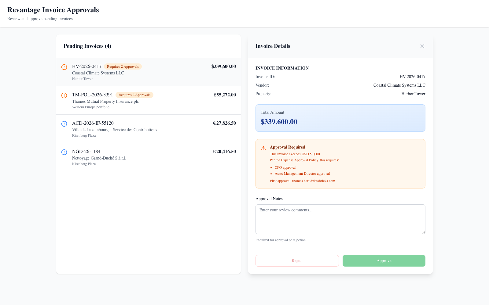

*Invoice approvals on Lakebase: the €312k chiller waits for a second approver.*

### Stage 1: Why Lakebase (5 min, talk)

A dashboard can show invoices; it can't hold *who approved what, when*, enforce two signatures, or stop unapproved rows reaching the GL.
That's transactional state: row-level updates, constraints, millisecond reads. Lakebase is managed Postgres next to the lakehouse; analytical data stays in Delta.

### Stage 2: Create the database objects (10 min)

Open **SQL Editor → Create new → Query**, then the compute picker → **More… → Lakebase Postgres → Provisioned → revantage-lux-ops → Attach**, and pick the database `revantage_ops` in the database dropdown (the instance page itself only offers psql connection details). Or your own instance: **Create database instance**, CU_1; ~5 min to provision.
**Watch for (seen in pre-build):** the database dropdown sometimes stays empty and the tab stays on `databricks_postgres`. Reload the tab, or ask everyone to use their own schema name (`approvals_<your_name>`) in whichever database is attached.
**Prompt** (Genie Code / Lakebase SQL editor):
> Create a Postgres schema approvals with a table invoice_approvals (invoice_id primary key, vendor_name, property_name, total_amount, currency, total_eur, status Pending/Approved/Rejected with a check constraint, first_approver, first_approved_at, reviewed_by, reviewed_at, notes, and a generated column requires_two_approvers = total_eur > 50000) and an audit table approval_events. The final approver must differ from the first approver.

**Expected:** DDL like `code/lakebase/d12_invoice_approvals.sql` (generated column + CHECK constraint).
**Checkpoint:** insert the 5 invoices (`code/lakebase/d12_reset.sql`), then
`SELECT invoice_id, total_eur, requires_two_approvers FROM approvals.invoice_approvals ORDER BY total_eur DESC` → HV-2026-0417 and TM-POL-2026-3391 are `true`.

### Stage 3: Approve in the app (10 min)

Open **Invoice Approvals** (the reference app). Everyone signs in with their own identity.
- Approve **PE-2026-06-0088** (€37.7k) with a note → *Invoice approved.*
- Approve **HV-2026-0417** (€312k) → *First approval recorded. Awaiting a second approver.* The panel shows "First approval: <you>".
- Try to approve HV-2026-0417 again yourself → **"The second approval must come from a different person (Expense Approval Policy)."**
- A second participant approves HV-2026-0417 → Approved.
**Checkpoint (Lakebase SQL):** `SELECT * FROM approvals.approval_events ORDER BY at` shows every action with the actor.
How it's wired: the app has a **database resource** (Lakebase) that injects PGHOST/PGUSER/PGDATABASE; its service principal logs in with an OAuth token; `code/app-approvals/src/lib/lakebase.ts` does each decision in a transaction with `SELECT … FOR UPDATE`.

### Stage 4: Only approved invoices reach the lakehouse (10 min)

Run the job **Approved invoices -> silver (Reference)** (Jobs & Pipelines → Run now).
**Expected:** `approved invoices in Lakebase: N`; `SELECT * FROM <catalog>.<schema>.silver_invoices` holds exactly the Approved ones. An invoice with only one signature isn't there.
Show on the job: **retries** (2, 60 s apart), **failure email**, **run history**, and the trigger (periodic 15 min, paused for the workshop).
**Prompt** (Genie Code, on the job's Python file):
> Explain how this job reads from Lakebase and why the MERGE makes re-runs safe.

Talk track on triggers: table-update ("data-readiness") triggers fire on Unity Catalog Delta tables, not on Postgres tables, so this job runs on a schedule or on demand. To trigger downstream work on approval, have the next job use a **table-update trigger on `silver_invoices`**.

### Stage 5: Reverse ETL (5 min)

**Catalog → `ref_d12_gold_property_quarterly_synced`**: a synced table copying certified gold into Postgres (snapshot mode).
**Checkpoint:** in Lakebase SQL, `SELECT count(*), sum(net_profit) FROM revantage_20261008.ref_d12_gold_property_quarterly_synced` → **80 rows, 64,214,088.70**, identical to gold. Apps read it in milliseconds without hitting a warehouse.

### Stage 6: Production health (5 min, show)

Pipeline and job health in one place: Jobs & Pipelines → runs, durations, failures; Demo 11's expectation metrics; Demo 16's data quality monitors and freshness.

### 7. Reset (facilitator)

`uv run --with "psycopg[binary]" code/lakebase/lakebase_sql.py --profile <p> --instance revantage-lux-ops --db revantage_ops -f code/lakebase/d12_reset.sql` and `TRUNCATE TABLE <catalog>.<schema>.silver_invoices`.

### Wrap-up

- **So what:** the approval workflow from Demo 4's extraction to the GL has state, a two-signature rule, an audit trail, and a hard gate, all next to the governed lakehouse.
- **Snowflake equivalent:** Hybrid Tables / Unistore for operational rows. Lakebase is full Postgres (extensions, drivers, apps) with synced tables from Delta and branching.
- **Verified:** 2026-10-08 on the FEVM workspace. Local Playwright 5/5 against Lakebase (queue order, single approval, reject, two-approver rule, same-person 409). Deployed app in the browser: first approval recorded, same-person second approval rejected with 409, single approval OK. Job run SUCCESS: only the Approved invoice landed in `silver_invoices`. Synced table online, 80 rows, sums match gold. State reset afterwards. **Stages 2 and 4 run in the Genie Code UI (S9):** S2 in the SQL editor attached to Lakebase Postgres (scratch schema `approvals_s9`, since dropped): status CHECK, `reviewed_by <> first_approver` CHECK, `GENERATED ALWAYS AS (total_eur > 50000) STORED`, audit table with FK; test rows 37,700 → false, 312,390.76 → true. S4 on the job file: correctly explained the REST-minted short-lived credential, the `status = 'Approved'` read, and MERGE on invoice_id as idempotent.

<a id="demo-13"></a>
## Demo 13: AI Gateway & Monitoring — "Who's using what, and what's it costing us?"

**Session:** Day 2, 11:30–12:15 (45 min) · **You build:** a usage + cost query pack and a SQL alert · **Reference:** `code/reference/d13_ai_gateway_queries.sql`, alert "[Revantage workshop] Daily AI tokens > 1M (Reference)"
**Starting state:** AI Gateway usage tracking (+ inference table `ref_d13_payload`) on `databricks-claude-sonnet-4-6`; read access to `system.ai_gateway`, `system.serving`, `system.billing` (**admin grant, check in pre-flight**)
**Where:** Serving → endpoint → AI Gateway; SQL editor with Genie Code; Alerts

**Important:** system tables cover the whole account/metastore. Every query filters on your workspace ID
(`:workspace_id`, the number after `?o=` in your browser URL). There's no `current_workspace_id()` function. Usage rows arrive with a delay of up to a few hours.

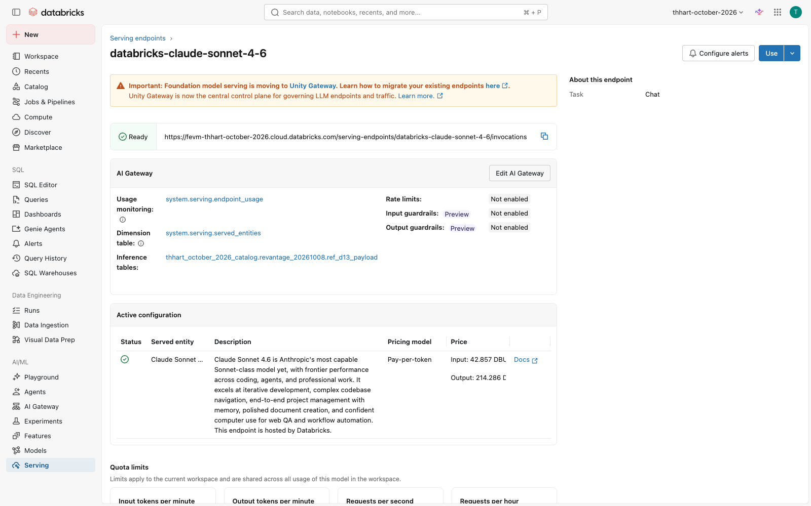

*AI Gateway on the Claude endpoint: usage tracking and the inference table.*

### Stage 1: Models without deploying (5 min)

**Serving** → show the pay-per-token endpoints already there (Claude, GPT, Llama, Qwen…). Open `databricks-claude-sonnet-4-6` → **AI Gateway**: usage tracking, inference table, rate limits, guardrails, fallbacks. Then call it from SQL:
```sql
SELECT ai_query('databricks-claude-sonnet-4-6', 'In one sentence: why did Harbor Tower miss its Q2 target?')
```

### Stage 2: Tokens by endpoint (7 min)

**Prompt** (Genie Code, SQL editor):
> Using system.ai_gateway.usage, show total requests, total tokens and average latency by endpoint (or service_name when endpoint_name is null) for workspace :workspace_id over the last 30 days.

**Expected:** like Q1 in the reference file. On the FEVM: `system.ai.gpt-5-6-sol` ~1.58M tokens (46 requests), plus ~135–145 calls each to **MCP services** (Gmail, Slack, Google Drive, Atlassian, Microsoft 365, GitHub). Those are Genie One connectors, governed through the same gateway.

**Then (pay-per-token models such as the one `ai_query` calls):**
> Show total requests, total tokens and errors (status_code >= 400) by endpoint for Foundation Model endpoints in workspace :workspace_id over the last 30 days using system.serving.endpoint_usage joined to system.serving.served_entities on served_entity_id.

**Expected:** like Q6: `databricks-claude-sonnet-4-6` with the workshop's `ai_query` traffic. Run in the Genie Code UI 2026-10-09: 4 FM endpoints; sonnet-4-6 37 requests, 10,387 tokens, the 3 deliberate errors.

### Stage 3: Who, and what fails (8 min)

> Show the top 5 users by tokens with their email masked like t***@domain, then the error rate (status_code >= 400) by endpoint.

**Expected:** masked requesters; error rate per endpoint (FEVM: gpt-5-6-sol 2.2%). Point out `routing_information` (fallback attempts) and `mcp_metadata` (which tool was called).

### Stage 4: What it costs (10 min)

> Estimate list-price cost by product and endpoint for the last 30 days by joining system.billing.usage to system.billing.list_prices on sku_name, cloud, usage_unit and the price validity window, for billing_origin_product in MODEL_SERVING, AI_GATEWAY, AI_FUNCTIONS, AGENT_BRICKS, VECTOR_SEARCH.

**Expected:** Q4 in the reference file. On the FEVM the biggest AI line was **VECTOR_SEARCH** for a Knowledge Assistant's index (~200 DBU, ~$14 of ~$19 in 30 days), more than all LLM calls. Lesson: KA indexes cost money while idle; delete the ones you don't use.

### Stage 5: Alert before the bill does (10 min)

> Write a query returning today's total tokens for workspace :workspace_id from system.ai_gateway.usage as a single column tokens_today.

**Alerts → Create alert** on that query: condition `tokens_today > 1000000`, schedule hourly, notify yourself (email).
**Checkpoint:** open the reference alert "Daily AI tokens > 1M (Reference)"; it evaluates OK today. Q5 shows **2026-10-05 at 1.47M tokens**, a day it would have fired.

### Stage 6: Governance tie-in (5 min, talk)

Usage and inference tables are Unity Catalog tables: grant, lineage, and retention like any data. Guardrails (PII, safety) and rate limits per user/group live on the gateway. The same view covers Genie, agents, Genie Code sessions, and MCP connectors.

### Wrap-up

- **So what:** one place to see every AI call, by person, model, and cost, with an alert before budget surprises.
- **Snowflake equivalent:** Cortex usage views (ACCOUNT_USAGE). The AI Gateway adds runtime controls (rate limits, guardrails, fallbacks, inference logging) across external and hosted models and MCP.
- **Verified:** 2026-10-08 on the FEVM workspace: all 5 reference queries run with real results (above); the alert deployed and ACTIVE, query returns `tokens_today`. 40 ai_query rows + 3 deliberate 400 errors were sent to sonnet-4-6 at 21:18 UTC; they landed in **`system.serving.endpoint_usage`** (14 batched requests, 1,110 tokens, 3 errors; reference Q6), and never in `system.ai_gateway.usage`, which covers the `system.ai.*` gateway (Genie One, MCP). The endpoint page also shows a banner that Foundation Model serving is moving to *Unity Gateway*: re-check which table the Revantage workspace uses in pre-flight. **Stages 2–5 run in the Genie Code UI (S9):** S2 8 rows identical to reference Q1 (7 MCP services + gpt-5-6-sol 1,577,845 tokens); S3 one masked user `t***@databricks.com`, gpt-5-6-sol error rate 2.17%, all MCP 0%; S4 Genie Code read both billing schemas and wrote the validity-window join: 19 rows, ~$19 total, VECTOR_SEARCH `ka-…-vs-endpoint` $14.02 the top line; S5 `tokens_today` = 0 (single column, ready for the alert).

<a id="demo-14"></a>
## Demo 14: Time Series Forecasting — "Where is revenue heading?"

**Session:** Day 2, 12:15–12:30 (15 min) · **You build:** a revenue forecast for 2026-Q3/Q4 vs target · **Reference:** `<catalog>.<schema>.ref_d14_revenue_forecast` (`code/reference/d14_forecast.sql`), dashboard page "Forecast"
**Starting state:** `gold_property_quarterly` (10 quarters per property, 2024-Q1..2026-Q2, `fiscal_quarter_date` = quarter start), `silver_quarterly_targets` (includes 2026-Q3/Q4 targets)
**Where:** SQL editor (a SQL warehouse: `ai_forecast` is disabled on serverless job compute)

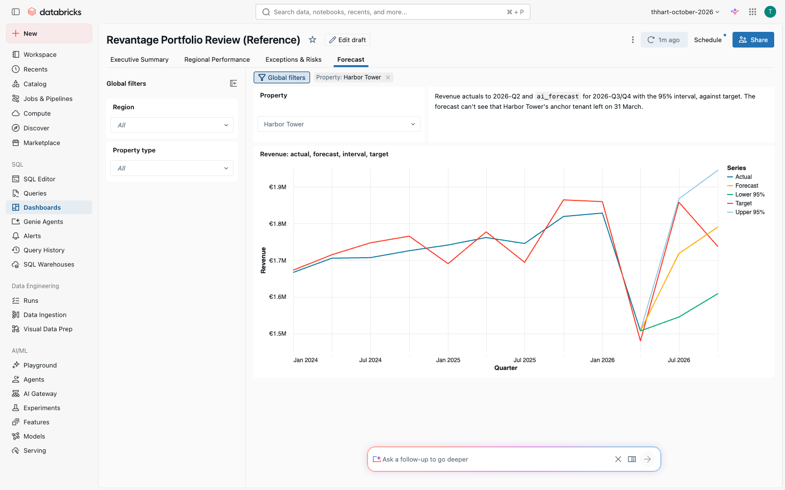

*Forecast page: actuals, ai_forecast with its interval, and the target.*

### Stage 1: One property (4 min)

**Prompt** (Genie Code):
> Forecast Harbor Tower's (property_id 3) quarterly revenue through 2026-12-31 with ai_forecast from <catalog>.<schema>.gold_property_quarterly.

**Expected SQL** (the agenda's `horizon => 2` form doesn't run; `frequency => 'Q'` fails on DATE columns, `'QS'` works):
```sql
SELECT * FROM AI_FORECAST(
  TABLE(SELECT fiscal_quarter_date, revenue FROM <catalog>.<schema>.gold_property_quarterly WHERE property_id = 3),
  horizon => '2026-12-31', time_col => 'fiscal_quarter_date', value_col => 'revenue', frequency => 'QS')
```
**Expected:** 2026-07-01 **≈ €1.71–1.72M** (95% interval ≈ 1.54–1.89M), 2026-10-01 ≈ €1.78–1.79M (values vary slightly run to run).
**Watch for (seen in pre-build):** Genie Code may *probe* `ai_forecast` on its own serverless compute, get `AI_FUNCTION_PREVIEW`, and tell you the function is disabled and an admin must enable a preview. That's misleading: click **Run** in the SQL editor (SQL warehouse) and the query it wrote works.

### Stage 2: Every property at once (3 min)

> Do the same for all properties at once using group_col.

**Expected:** 16 rows (8 properties × 2 quarters), columns `property_id, fiscal_quarter_date, revenue_forecast, revenue_upper, revenue_lower`.

### Stage 3: Who will miss budget? (4 min)

> Join the forecast to silver_quarterly_targets (fiscal_quarter = year-Qn of fiscal_quarter_date) and list properties whose 2026-Q3 forecast is below revenue_target.

**Expected:** exactly **Harbor Tower** (€1.72M vs €1.86M target) and **Zuidas Residences** (€1.32M vs €1.43M).

### Stage 4: Know the limits (4 min, talk)

Harbor Tower's actual Q2 revenue was **€1.51M** after the anchor tenant left on 31 March, yet the forecast says €1.72M for Q3.
`ai_forecast` sees only the revenue history, not the lease roll. When the drivers are known (lease expiries, vacancy), use **Prophet with regressors** or a lease-roll model in a notebook (MLflow-tracked); ARIMA for smooth series; GARCH/AR when the volatility itself matters (rates, FX), not for rent.
**So what for FP&A:** `ai_forecast` is a fast, governed first pass across hundreds of properties in one SQL statement; spend data-science time on the exceptions it flags.
Show the dashboard's **Forecast** page (Demo 8 reference): actual, forecast, 95% interval, target.

### Wrap-up

- **Snowflake equivalent:** `SNOWFLAKE.ML.FORECAST` (create a model object, then call it). `ai_forecast` is a single table-valued function call, no model object to manage.
- **Verified:** 2026-10-08 on the FEVM warehouse: single-property numbers above; grouped forecast + target join returns exactly Harbor Tower and Zuidas for 2026-Q3; `ref_d14_revenue_forecast` = 80 actual + 16 forecast rows; dashboard page checked in the browser. Stage 1 run in the Genie Code UI (S9): correct query (`QS`, `fiscal_quarter_date`, through 2026-12-31) returning €1,709,781 for 2026-Q3 on the warehouse, after the misleading 'disabled' probe noted above. **Stages 2–3 (one combined prompt, S9):** Genie Code probed V2 and V1 (both 'disabled' again), wrote the grouped forecast + target join anyway, ran it on the warehouse and returned exactly Harbor Tower 1,709,780.95 vs 1,858,200 (−8.0%) and Zuidas 1,326,134.51 vs 1,425,400 (−7.0%).

<a id="demo-15"></a>
## Demo 15: Hands-On Lab — Build Your Own

**Session:** Day 2, 1:30–2:30 (60 min) · Pick one track. Each starts from an asset you've already seen working, so you always have a fallback.
**Where:** your sandbox schema `<my_schema>` (or `<schema>` with `_<your_name>` suffixes), Genie Code throughout

### Track A — Analyst: a Genie Agent for your domain

1. Genie → **New** → name `<your domain> Q&A – <your_name>`; add `gold_property_quarterly`, `silver_leases`, `silver_tenants` (and your own tables if you have dev access).
2. **Instructions:** start from the Reference agent's text (open *Revantage Portfolio Q&A (Reference)* → Configure → Instructions) and adapt the definitions to your domain: latest quarter, net profit definition, what "risk" means.
3. Add 3 **SQL examples** for your hardest questions, synonyms on 3 columns, and join specs.
4. Test 5 questions; for each wrong answer, fix the *context* (instruction, example, synonym), not the question.
   **Benchmark** (should pass after Stage 3): "Which leases expire in the next 90 days and what is the monthly rent at risk?" → 6 leases, €103k (as of 2026-10-08).
- **Fallback:** duplicate the Reference agent and edit it.

### Track B — Dashboard builder: your portfolio company's page

1. New dashboard; datasets on the metric views (`ref_mv_*` or your Demo 7 views) filtered to your region or property type.
2. **Prompt** (Genie Code in the dashboard editor):
   > Build a page for <region> with net profit margin and target attainment counters for 2026-Q2, a net profit trend by property, and a table of leases expiring in 180 days from silver_leases.
3. Add the dashboard's **Ask Genie**; publish; share with a colleague.
- **Fallback:** clone "Revantage Portfolio Review (Reference)" and filter it.

### Track C — Data engineer: a new source, end to end

1. Pick a source: a CSV you bring, or the `documents/invoices` extraction from Demo 4 (`ai_extract` in a pipeline).
2. **Prompt** (Genie Code, pipeline editor, Agent mode):
   > Create a pipeline that ingests <path> with Auto Loader into bronze, cleans it into silver with an expectation that drops rows missing <key> and fails the update when <amount> doesn't parse, and builds a gold summary.
3. **Jobs & Pipelines → Create job**: task 1 = your pipeline, task 2 = a SQL task that checks row counts; schedule daily 06:00; email on failure; 2 retries.
4. Add a SQL alert on a gold metric (copy the pattern from "Daily AI tokens > 1M (Reference)").
- **Fallback:** copy `code/pipelines/ref_property_pipeline/` (Demo 11) and change the paths.

### 4. Closing the lab (5 min)

Each person shows one thing they built. Collect follow-ups for the 4:15 "Next steps" session.

- **Verified:** the starting assets for each track are verified (Demos 2, 7, 8, 9, 11, 13). The lab itself is open-ended; the Track A benchmark numbers come from the lease tracker app (Demo 9).

<a id="demo-16"></a>
## Demo 16: Data Quality & Observability — "Trust scorecard"

**Session:** Day 2, 3:45–4:15 (30 min) · **You build:** quality monitoring on the gold table, a bad-load detector, and the blast radius · **Reference:** data profiling monitor on `gold_property_quarterly` (bundle target `revantage`), alert "[Revantage workshop] Revenue > 3 sigma from property mean (Reference)", `code/reference/d16_revenue_outliers.sql`, `d16_blast_radius.sql`
**Starting state:** clean `gold_property_quarterly` (80 rows, 2024-Q1..2026-Q2); seed/reset scripts `code/sql/d16_seed_bad_row.sql` / `d16_reset.sql` (`${table}` = `gold_property_quarterly`)
**Where:** Catalog Explorer → table → **Quality** tab; SQL editor with Genie Code; Alerts

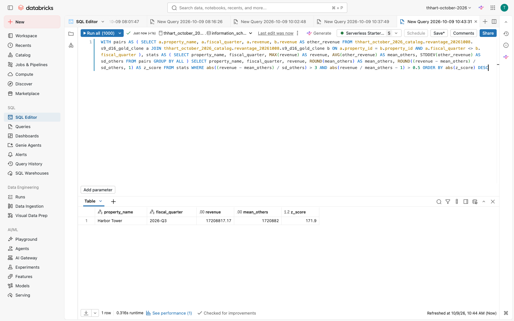

*After the bad load the leave-one-out rule flags exactly Harbor Tower 2026-Q3 (z = 171.9).*

### Stage 1: Turn on monitoring (5 min)

Catalog → `gold_property_quarterly` → **Quality → Enable data profiling** (Snapshot, slice by `region_name`), and at schema level **anomaly detection** (freshness, completeness).
**Expected:** a profile dashboard and two output tables (`…_profile_metrics`, `…_drift_metrics`) after the first refresh (a few minutes).
**FEVM note:** the FEVM metastore is at its 1,000-monitor limit, so we couldn't create one here. In Revantage's workspace the bundle target creates it; show the profile from the Oct 5 workshop's monitor if needed.

### Stage 2: Read the profile (5 min)

Profile dashboard: per-column null %, distinct counts, min/max/quantiles, per region slice. Freshness = last commit time.
**Prompt** (Genie Code):
> Using <catalog>.<schema>.gold_property_quarterly_profile_metrics, show null rate and max for revenue and net_profit in the latest window.

### Stage 3: A bad load arrives (facilitator, 2 min)

Run `code/sql/d16_seed_bad_row.sql` with `${table}` = `gold_property_quarterly`: inserts **Harbor Tower 2026-Q3** with revenue **10× its average (€17.2M)** and **NULL net_profit**.

### Stage 4: Detect it (8 min)

- **Completeness:** `SELECT COUNT(*) FROM <catalog>.<schema>.gold_property_quarterly WHERE net_profit IS NULL` → 1. Refresh the monitor: net_profit null % > 0, revenue max jumps, drift on revenue flagged.
- **Outlier rule:** run `code/reference/d16_revenue_outliers.sql`.
  **Expected:** exactly one row: Harbor Tower 2026-Q3, **z ≈ 172** vs its other quarters (mean €1.72M).
  **Teach:** a plain "> 3σ" rule on smooth financial series also flags real business moves. Before the seed it flagged Harbor Tower's vacancy and a new Kirchberg suite. The rule therefore uses leave-one-out σ **and** a > 50% materiality guard: **0 rows on clean data, 1 after the seed**.
**Prompt** (Genie Code):
> Write a query on <catalog>.<schema>.gold_property_quarterly that flags property-quarters whose revenue is more than 3 standard deviations from the mean of that property's OTHER quarters (leave-one-out: exclude the quarter being tested from the mean and standard deviation) and more than 50% away from that mean. Run it.

**Expected:** 0 rows before the seed (Genie Code also shows that Harbor Tower 2026-Q2 at z 4.5 and Kirchberg 2026-Q2 at z 3.9 pass 3σ but fail the 50% guard: real business moves); after the seed exactly Harbor Tower 2026-Q3, z ≈ 172.
**Watch for (seen in pre-build):** without the explicit leave-one-out sentence Genie Code computed mean and σ over *all* quarters including the one tested. With 11 quarters a single spike can then never exceed z ≈ 3.02, however large: the 10× seed scored 3.01 and only just passed. Good teaching moment: ask "does the σ include the quarter being tested?"

### Stage 5: Blast radius (5 min)

Catalog Explorer → **Lineage** on the table, or run `code/reference/d16_blast_radius.sql`.
**Expected downstream:** `ref_mv_net_profit_margin`, `ref_mv_target_attainment`, `ref_mv_qoq_revenue_growth`, the Portfolio Review dashboard (DASHBOARD_V3), `ref_d14_revenue_forecast`, `ref_d03_property_performance_v`, `ref_d06_property_quality_checks`, `customer_performance`, and the Genie Agents that read them. One bad row reaches every board number.

### Stage 6: Alert (5 min)

Open the reference alert (daily 07:00 Luxembourg, notifies the owner): it counts outliers and fires when > 0. Create your own from the Stage 4 query, wrapped as `SELECT COUNT(*) AS outliers FROM (…)`.

### 7. Reset (facilitator, immediately after)

Run `code/sql/d16_reset.sql` (deletes the 2026-Q3 row). Re-check: outlier query → 0 rows, NULL count → 0.

### Wrap-up

- **So what:** quality issues are caught by the platform (profiling, expectations, alerts) before a business user finds them, and lineage shows exactly what they would have broken.
- **Snowflake equivalent:** Data Metric Functions + ACCESS_HISTORY. Here profiling, anomaly detection, pipeline expectations, alerts, and lineage come together in Unity Catalog.
- **Verified:** 2026-10-08 on the FEVM workspace, rehearsed on a deep clone (`ref_d16_gold_sandbox`, since dropped): seed inserted €17.2M / NULL; outlier query 0 rows on clean gold, 1 row (z 171.9) after the seed; the reference alert is deployed. Lineage query returns the downstream list above. **Stage 4 run in the Genie Code UI (S9):** the original prompt produced inclusive stats (seed z 3.01, fragile); the leave-one-out prompt above gave 0 rows on clean gold and, on a seeded clone (`s9_d16_gold_clone`, since dropped), exactly Harbor Tower 2026-Q3 z 171.89. **Not verified on the FEVM:** creating the profiling monitor (metastore limit) and therefore Stage 2's prompt, which needs the `_profile_metrics` table; run it in the Revantage workspace pre-flight.
